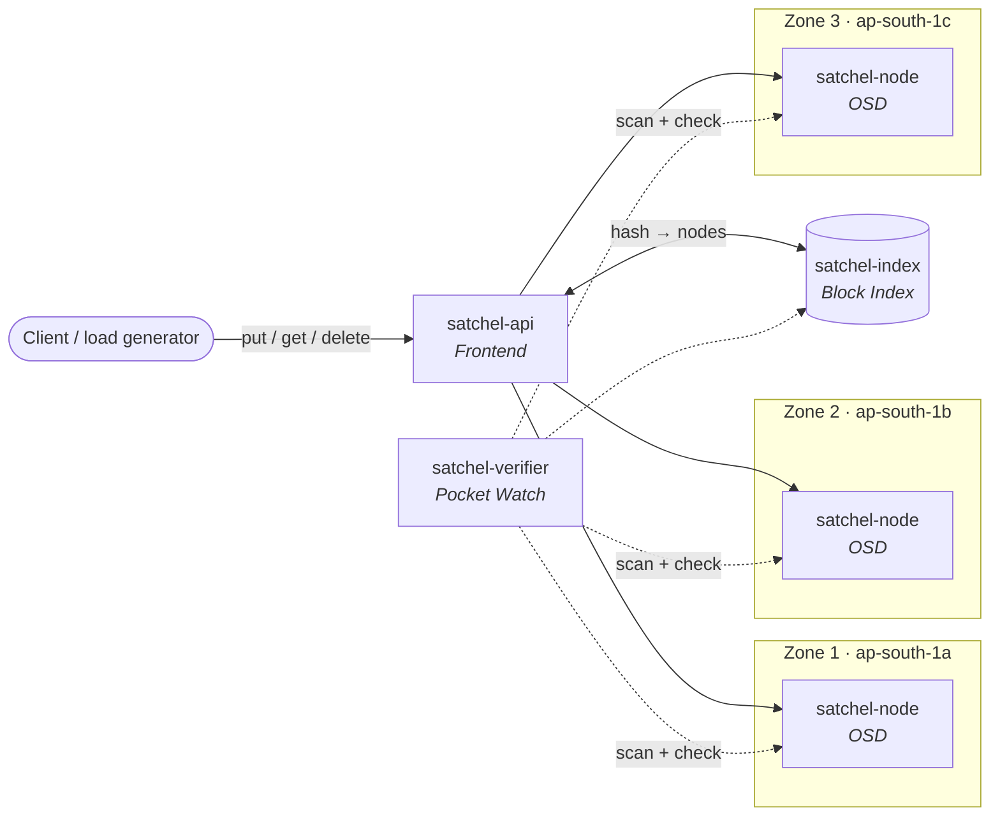

<div align="center">

# 🎒 Satchel

**A pocket-sized clone of Dropbox's Magic Pocket.**

Satchel rebuilds the core of the storage system Dropbox wrote to move off AWS S3, at small scale. It justifies every design choice against Dropbox's public sources and asks one question: *at what scale does owning storage beat renting it?*

[](https://github.com/frectrium/Satchel/actions/workflows/ci.yml)
[](LICENSE)
[](https://www.rust-lang.org)
[](https://github.com/users/frectrium/projects/1)

[Project brief](docs/SATCHEL_PROJECT.md) · [This week](https://github.com/frectrium/Satchel/issues/10) · [Issues](https://github.com/frectrium/Satchel/issues) · [Milestones](https://github.com/frectrium/Satchel/milestones) · [Contributing](CONTRIBUTING.md)

</div>

---

## Why this project

In 2016 Dropbox announced it had moved most user file data off **AWS S3** and onto **Magic Pocket**, an exabyte-scale block storage system running in its own data centers. It later reported large infrastructure savings. Moving workloads off the public cloud like this is called **cloud repatriation**.

Satchel is a cloud computing case study in two halves:

1. **📚 Case study.** Use primary sources to work out why Dropbox left S3, how Magic Pocket is built, what it cost, and how it turned out.
2. **🛠️ Exercise.** Build a working, scaled-down Magic Pocket, deploy it across three AWS availability zones, measure it, and model the case's workload cost on **AWS**, **Azure** and an **on-premises** estimate.

## What Satchel builds

Each component of Satchel mirrors a component of Magic Pocket:

| Satchel | Role | Magic Pocket counterpart |
|---|---|---|
| `satchel-api` | Accepts put, get and delete requests for blocks | Frontends |
| `satchel-common::BlockHash` | Immutable blocks keyed by content hash, so identical data is stored once | Block storage model |
| `satchel-index` | Maps each block hash to the storage nodes holding it | Block Index |
| `satchel-node` | Stores block data on disk | OSDs |
| Replication | Keeps copies of each block across zones | Cross-zone replication |
| Erasure coding | Data and parity fragments across nodes, so the cluster survives node loss with less overhead than full copies | Erasure-coded volumes |
| `satchel-verifier` | Background integrity checks of stored blocks | Pocket Watch |

The deployment pieces cover what Dropbox ran on its own hardware: multi-AZ placement, Docker, Terraform, horizontal scaling, and Prometheus with Grafana for observability.



> **Out of scope:** exabyte scale, production-grade durability guarantees, custom hardware (we model it on paper instead), and Dropbox's sync engine and metadata systems.

## Getting started

### Prerequisites

| Tool | Why | Install |
|---|---|---|
| Rust (stable, ≥ 1.91) | Build Satchel | [rustup.rs](https://rustup.rs) |
| Docker + Compose v2 | Run the local multi-zone cluster | [Docker Desktop](https://www.docker.com/products/docker-desktop/) |
| `gh` (optional) | Issues and PRs from the terminal | `brew install gh` |

### Clone and build

```bash
git clone https://github.com/frectrium/Satchel.git
cd Satchel
cargo build --workspace
cargo test --workspace
```

### Run the local cluster

This starts one frontend, the Block Index, the verifier, and one storage node in each of three simulated zones:

```bash
docker compose up --build
```

```bash
curl localhost:8080/health
```

| Service | Host port | Zone |
|---|---|---|
| `api` | 8080 | none |
| `index` | 8081 | none |
| `verifier` | 8085 | none |
| `node-z1` / `node-z2` / `node-z3` | 8091 / 8092 / 8093 | z1 / z2 / z3 |

You can also run a single service without Docker:

```bash
SATCHEL_PORT=8090 SATCHEL_ZONE=z1 cargo run -p satchel-node
```

> The services are skeletons that only serve `GET /health` for now. See [Status](#status).

## Repository layout

```
Satchel/
├── crates/
│   ├── satchel-common/     # BlockHash, service config, /health, shutdown
│   ├── satchel-api/        # Frontend
│   ├── satchel-index/      # Block Index
│   ├── satchel-node/       # Storage node (OSD)
│   └── satchel-verifier/   # Background verifier (Pocket Watch)
├── docs/
│   ├── SATCHEL_PROJECT.md  # Project brief
│   └── sources/            # Source Log: every citation, with a stable ID
├── .github/                # CI, issue forms, PR template, CODEOWNERS
├── Dockerfile              # One image, all binaries
└── docker-compose.yml      # Local 3-zone dev cluster
```

## Status

**Current week:** Week 1, Sources & Summary (due Tuesday 20 October 2026). The plan for the week, with its tasks as sub-issues, is in [#10](https://github.com/frectrium/Satchel/issues/10).

### Done

- Project brief, Source Log template and docs structure
- Cargo workspace with skeleton services (`api`, `index`, `node`, `verifier`) and a shared `BlockHash` type with tests
- Dockerfile and a local 3-zone Docker Compose cluster
- CI on every PR and on `main`: fmt, clippy, tests, Docker image build and a Compose config check
- `main` protected: PRs need 1 approval, resolved conversations and green CI, and are squash-merged
- Dependabot for Cargo, GitHub Actions and Docker
- Issue forms, PR template, CODEOWNERS and a [contributing guide](CONTRIBUTING.md)
- Issues for every week, grouped under each week's deliverable issue, on the [project board](https://github.com/users/frectrium/projects/1)

### Next

- **Week 1:** collect primary sources and write the one-page summary
- **Week 2:** case analysis, exercise plan, test strategy, integration test harness, AWS groundwork
- **Week 3:** build the storage path, deploy to AWS with Terraform, run experiments and cost models
- **Week 4:** final report and a tagged release
- **Week 5:** viva

## Roadmap

| Week | Focus | Deliverable |
|---|---|---|
| **1** | Find primary sources. Extract architecture, cost and outcome data | One-page summary of sources and key points |
| **2** | Case analysis, architecture diagram, exercise plan (incl. erasure coding parameters), Team Roles, Design Decision Log | 10-page report |
| **3** | Build Satchel's core, deploy to AWS, measure latency, scaling and cost | Report add-ons with results |
| **4** | Report preparation. Fold in the Design Decision Log | Final report |
| **5** | Project viva | Viva presentation |

Each week is a [milestone](https://github.com/frectrium/Satchel/milestones). Its deliverable issue holds the plan for the week, with that week's tasks as sub-issues. Progress is on the [project board](https://github.com/users/frectrium/projects/1).

## Team

| | Member |
|---|---|
|  | [@frectrium](https://github.com/frectrium) |
|  | [@VyasGuru](https://github.com/VyasGuru) |
|  | [@jasmehta08](https://github.com/jasmehta08) |

## Contributing

Read [CONTRIBUTING.md](CONTRIBUTING.md) before your first PR. It covers how we create branches, commit, test, review and merge, what `main`'s protection requires, and how we handle sources.

## License

[MIT](LICENSE).

<sub>Satchel is an independent educational project. It is not affiliated with or endorsed by Dropbox, Inc. "Dropbox" and "Magic Pocket" are trademarks of their respective owners.</sub>
