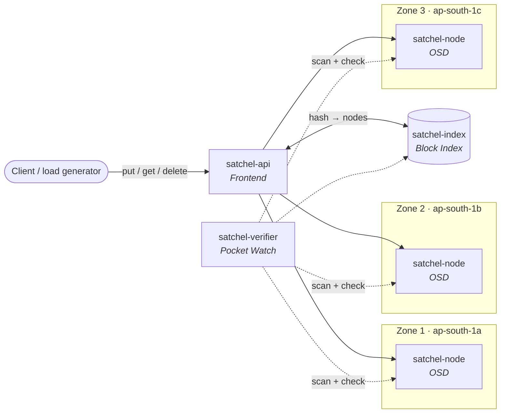

<div align="center">

# 🎒 Satchel

**A pocket-sized clone of Dropbox's Magic Pocket.**

Satchel rebuilds the core of the storage system Dropbox wrote to move off AWS S3, at small scale. It justifies every design choice against Dropbox's public sources and asks one question: *at what scale does owning storage beat renting it?*

[](https://github.com/frectrium/Satchel/actions/workflows/ci.yml)
[](LICENSE)
[](https://www.rust-lang.org)
[](https://github.com/users/frectrium/projects/1)

[Project brief](docs/SATCHEL_PROJECT.md) · [This week](https://github.com/frectrium/Satchel/issues/10) · [Issues](https://github.com/frectrium/Satchel/issues) · [Milestones](https://github.com/frectrium/Satchel/milestones) · [Contributing](CONTRIBUTING.md)

</div>

---

## Why this project

In 2016 Dropbox announced it had moved most user file data off **AWS S3** and onto **Magic Pocket**, an exabyte-scale block storage system running in its own data centers. It later reported large infrastructure savings. Moving workloads off the public cloud like this is called **cloud repatriation**.

Satchel is a cloud computing case study in two halves:

1. **📚 Case study.** Use primary sources to work out why Dropbox left S3, how Magic Pocket is built, what it cost, and how it turned out.
2. **🛠️ Exercise.** Build a working, scaled-down Magic Pocket, deploy it across three AWS availability zones, measure it, and model the case's workload cost on **AWS**, **Azure** and an **on-premises** estimate.

## What Satchel builds

Each component of Satchel mirrors a component of Magic Pocket:

| Satchel | Role | Magic Pocket counterpart |
|---|---|---|
| `satchel-api` | Accepts put, get and delete requests for blocks | Frontends |
| `satchel-common::BlockHash` | Immutable blocks keyed by content hash, so identical data is stored once | Block storage model |
| `satchel-index` | Maps each block hash to the storage nodes holding it | Block Index |
| `satchel-node` | Stores block data on disk | OSDs |
| Replication | Keeps copies of each block across zones | Cross-zone replication |
| Erasure coding | Data and parity fragments across nodes, so the cluster survives node loss with less overhead than full copies | Erasure-coded volumes |
| `satchel-verifier` | Background integrity checks of stored blocks | Pocket Watch |

The deployment pieces cover what Dropbox ran on its own hardware: multi-AZ placement, Docker, Terraform, horizontal scaling, and Prometheus with Grafana for observability.



> **Out of scope:** exabyte scale, production-grade durability guarantees, custom hardware (we model it on paper instead), and Dropbox's sync engine and metadata systems.

## Install Satchel on your computer

One command downloads the latest release for macOS or Linux into `~/satchel` and starts a small Satchel cluster: a Block Index, 3 storage nodes (one per simulated zone), the frontend, the verifier with the Master, and the files API on `127.0.0.1:47800`. Nothing needs root and nothing listens outside `127.0.0.1`.

```bash
curl -fsSL https://raw.githubusercontent.com/frectrium/Satchel/main/scripts/install.sh | bash
```

Then store and read back a file:

```bash
curl -X POST --data-binary @photo.jpg "http://127.0.0.1:47800/v1/files?name=photo.jpg"
curl http://127.0.0.1:47800/v1/files                       # what's stored
curl -o copy.jpg http://127.0.0.1:47800/v1/files/1/content # read it back
curl http://127.0.0.1:47800/v1/stats                       # blocks, dedup and raw bytes per node
```

`~/satchel/bin/satchel` starts, stops and checks the cluster (`start`, `stop`, `status`, `logs`, `uninstall`). Set `SATCHEL_VERSION=v1.0.0` to install a specific release, or `SATCHEL_HOME` for another directory.

| Files API | What it does |
|---|---|
| `POST /v1/files?name=` | Store the request body as a file: split into 4 MiB blocks, each stored once by SHA-256 on 3 nodes |
| `GET /v1/files` | Every file, newest first |
| `GET /v1/files/{id}` | One file with its ordered block list |
| `GET /v1/files/{id}/content` | The file's bytes, read block by block and checked against each hash |
| `DELETE /v1/files/{id}` | Remove a file, and drop blocks no other file uses |
| `GET /v1/stats` | Files, logical bytes, unique blocks, bytes saved by dedup, raw bytes on each node |
| `GET /v1/info` | Version, block size, replica count and nodes |

## Getting started

### Prerequisites

| Tool | Why | Install |
|---|---|---|
| Rust (stable, ≥ 1.91) | Build Satchel | [rustup.rs](https://rustup.rs) |
| Docker + Compose v2 | Run the local multi-zone cluster | [Docker Desktop](https://www.docker.com/products/docker-desktop/) |
| `gh` (optional) | Issues and PRs from the terminal | `brew install gh` |

### Clone and build

```bash
git clone https://github.com/frectrium/Satchel.git
cd Satchel
cargo build --workspace
cargo test --workspace
```

### Run the local cluster

This starts one frontend, the Block Index, the verifier, and one storage node in each of three simulated zones:

```bash
docker compose up --build
```

```bash
curl localhost:8080/health
```

| Service | Host port | Zone |
|---|---|---|
| `api` | 8080 | none |
| `index` | 8081 | none |
| `verifier` | 8085 | none |
| `node-z1-1` through `node-z3-3` | 8091 through 8099 | three nodes in each of z1, z2, z3 |
| `prometheus` | 9090 | none |
| `grafana` | 3000 | none |

You can also run a single service without Docker:

```bash
SATCHEL_PORT=8090 SATCHEL_ZONE=z1 cargo run -p satchel-node
```

> Storage nodes persist replicas and fragments under `/data`; use `SATCHEL_DATA_DIR` to select another directory outside Compose. See [Status](#status).

### Metrics and dashboards

Every service serves Prometheus metrics on `GET /metrics`: request counts and latency histograms by route and status, CPU and memory, and bytes stored on each storage node. Prometheus scrapes them every 5 seconds, and Grafana opens on the **Satchel overview** dashboard:

```bash
open http://localhost:3000   # Grafana, no login needed to view
open http://localhost:9090   # Prometheus
```

The config is in [`observability/`](observability/). When the cluster grows, add the new nodes to `observability/prometheus.yml`.

### Run the integration tests

The integration tests in `crates/satchel-it` drive the running services over HTTP. One command builds the image, starts the cluster, runs the tests, prints the cluster logs if anything fails and tears everything down:

```bash
scripts/integration-test.sh
```

They cover every Satchel service in `docker-compose.yml`, so they need no change when the cluster grows. `cargo test --workspace` skips them, because they need a cluster. To run them against a cluster that is already up, run the command below. Each service's URL defaults to its host port, and `SATCHEL_IT_<SERVICE>_URL` overrides it, for example `SATCHEL_IT_NODE_Z1_URL`:

```bash
cargo test -p satchel-it -- --ignored
```

CI runs the same script on every PR, in the **Integration tests (Compose)** job.

### Run an experiment

`satchel-bench` puts and gets blocks against the cluster and writes exact latency percentiles and throughput as JSON. See [docs/experiments](docs/experiments/README.md) for every option and the S3 run.

```bash
cargo run --release -p satchel-bench -- --block-size 2MiB --clients 16 --out docs/results/e1/run.json
```

### Run the cost calculator

`satchel-cost` prices the case workload (#15) on AWS, Azure, on-prem and Satchel on EC2, and finds the data volume at which owning breaks even. Every default price is in the TOML files in `crates/satchel-cost/prices/`, tagged with its Source Log ID, and the method is in [`docs/cost/method.md`](docs/cost/method.md). Inputs that are proposed, assumed or not yet sourced are listed in `flagged-inputs.csv` and on every run.

```bash
cargo run -p satchel-cost                                  # base case summary
cargo run -p satchel-cost -- --list                        # sensitivity cases
cargo run -p satchel-cost -- --prices crates/satchel-cost/prices --out docs/cost/output
```

The same engine runs in the browser as the pricing calculator page (#54): change the workload, redundancy or on-prem costs and the totals, layouts and break-even point update live. The frontend serves it at [localhost:8080/calculator](http://localhost:8080/calculator) once the cluster is up, and it's published to GitHub Pages from `main`. The page loads `crates/satchel-calc` compiled to WASM from `web/calculator/pkg`, so after changing the cost engine, rebuild that bundle and commit it:

```bash
scripts/build-calculator.sh    # needs the wasm32 target and wasm-bindgen-cli 0.2.130
```

## Repository layout

```
Satchel/
├── crates/
│   ├── satchel-common/     # BlockHash, service config, /health, shutdown
│   ├── satchel-api/        # Frontend
│   ├── satchel-index/      # Block Index
│   ├── satchel-node/       # Storage node (OSD)
│   ├── satchel-verifier/   # Background verifier (Pocket Watch) and the Master
│   ├── satchel-files/      # Files as block lists, the API the local install serves
│   ├── satchel-cost/       # Sizing and cost model behind the calculator
│   ├── satchel-calc/       # The cost model as a JSON API, compiled to WASM
│   ├── satchel-it/         # Integration tests against a running cluster
│   └── satchel-bench/      # Load generator for the experiments
├── docs/
│   ├── SATCHEL_PROJECT.md  # Project brief
│   └── sources/            # Source Log: every citation, with a stable ID
├── observability/          # Prometheus config, Grafana provisioning and dashboards
├── web/app/                # The Satchel website (React, Vite, TypeScript)
├── web/calculator/         # Pricing calculator page and its WASM bundle
├── scripts/                # install.sh, satchel launcher, integration-test.sh, package-release.sh, build-calculator.sh
├── .github/                # CI, issue forms, PR template, CODEOWNERS
├── Dockerfile              # One image, all binaries
└── docker-compose.yml      # Local 3-zone dev cluster
```

## Status

**v2.0.0**: the storage system and website of v1.1.0, plus compaction (`satchel compact`) that reclaims deleted space and erasure codes volumes, reads from coded volumes, a storage view in My files and the redesigned calculator. See [CHANGELOG.md](CHANGELOG.md).

### Done

- Storage path: frontend, Block Index and Replication Table on SQLite, storage nodes with fsync'd extents, Master with zone-aware volumes, RS(6,3) codec, verifier with the Disk Scrubber, Metadata Scanner and repair
- Compaction and coding on demand (`satchel compact`), and reads from coded volumes, including with fragments missing
- Files on top of blocks: `satchel-files` with a manifest of block lists (DDL-020) and a one-command local install
- Prometheus metrics and a Grafana dashboard for every service
- Cost model: sizing, the `satchel-cost` engine and CLI, AWS, Azure and on-prem estimates and the break-even point
- Load generator for Satchel and S3, integration tests on the Compose cluster
- Terraform for the 3-AZ AWS demo cluster and an arm64 image on GitHub Container Registry
- CI on every PR: fmt, clippy, tests, Docker build, Compose integration tests and Terraform checks

### Next

- Horizontal scaling (#73), the scaling experiment (#75) and an architecture change measured before and after (#106)

## Roadmap

| Week | Focus | Deliverable |
|---|---|---|
| **1** | Find primary sources. Extract architecture, cost and outcome data | One-page summary of sources and key points |
| **2** | Case analysis, architecture diagram, exercise plan (incl. erasure coding parameters), Team Roles, Design Decision Log | 10-page report |
| **3** | Build Satchel's core, deploy to AWS, measure latency, scaling and cost | Report add-ons with results |
| **4** | Report preparation. Fold in the Design Decision Log | Final report |
| **5** | Project viva | Viva presentation |

Each week is a [milestone](https://github.com/frectrium/Satchel/milestones). Its deliverable issue holds the plan for the week, with that week's tasks as sub-issues. Progress is on the [project board](https://github.com/users/frectrium/projects/1).

## Team

| | Member |
|---|---|
|  | [@frectrium](https://github.com/frectrium) |
|  | [@VyasGuru](https://github.com/VyasGuru) |
|  | [@jasmehta08](https://github.com/jasmehta08) |

## Contributing

Read [CONTRIBUTING.md](CONTRIBUTING.md) before your first PR. It covers how we create branches, commit, test, review and merge, what `main`'s protection requires, and how we handle sources.

## License

[MIT](LICENSE).

<sub>Satchel is an independent educational project. It is not affiliated with or endorsed by Dropbox, Inc. "Dropbox" and "Magic Pocket" are trademarks of their respective owners.</sub>
