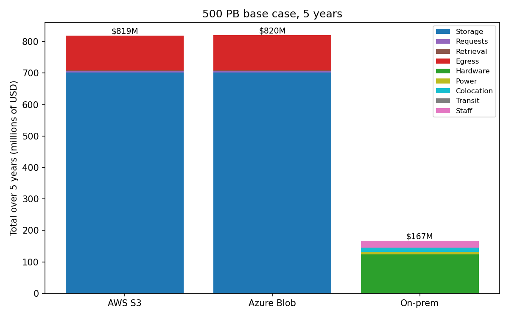
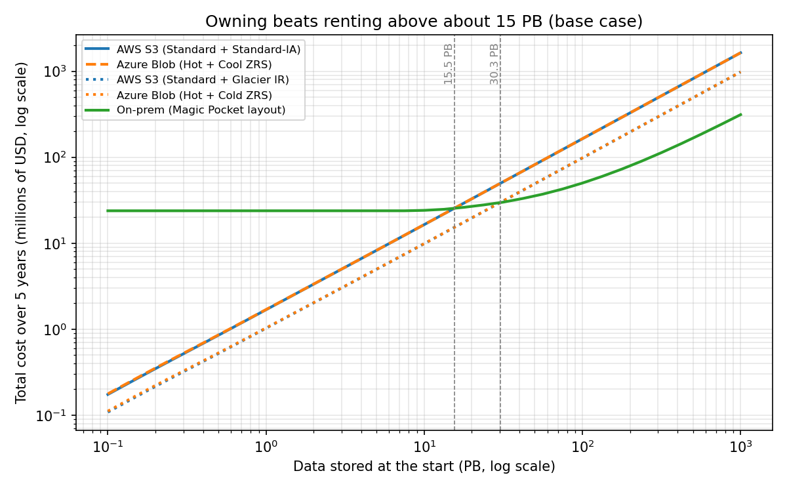
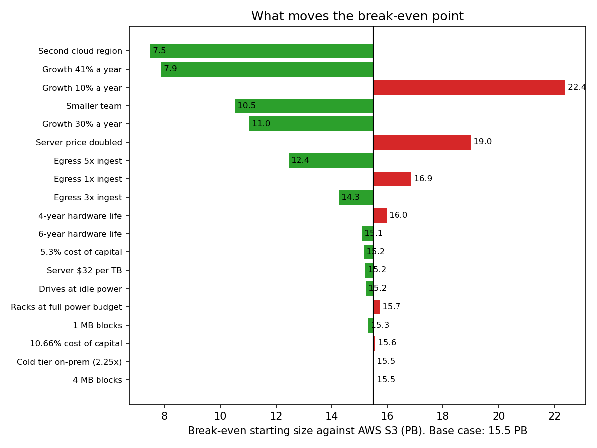

# Cost comparison: AWS vs Azure vs on-prem, and the break-even point

Issue #26. The core question of the exercise: **at what scale, and under what assumptions, does owning storage beat renting it?** This becomes the cost chapter of the final report (#28).

Source IDs refer to the [Source Log](../sources/README.md). Numbers we worked out are marked *(our calc)*.

## How the numbers are made

Every figure comes from the cost engine, `satchel-cost` (#52), so the tables, the charts and the calculator web UI (#54) share one model:

```bash
cargo run -p satchel-cost -- --scenario all --format csv   # docs/cost/output/
scripts/plot-cost.py                                        # docs/cost/charts/
```

| Input | Where it comes from |
|---|---|
| Workload: 500 PB at the start, 20% growth, 5 years, 2 MB blocks, egress 2 x ingest | Workload model (#15) |
| AWS S3 in Mumbai | [`aws/`](aws/README.md) (#23). The engine matches the calculator export to within 0.01% |
| Azure Blob Storage in Central India | [`azure/`](azure/README.md) (#24). The engine matches the calculator to within 0.01% |
| On-prem hardware | [`on-prem/hardware.md`](on-prem/hardware.md) (#25, Parshv). The engine reproduces its server, rack and switch counts and its capex |
| On-prem staff and amortization | [`on-prem/staff-amortization.md`](on-prem/staff-amortization.md) (#25, Jas) |
| On-prem power, space and transit | `docs/cost/method.md` with the references in `onprem.toml`, until the third part of #25 (Guru) lands: drives at 0.50 W per TB [B12], PUE 1.49 [H6], $0.0977 per kWh [H4], $172.50 per kW-month of colocation [H7], $0.08 per Mbps-month of transit [H9]. The engine lists every input that is still proposed or assumed in `docs/cost/output/flagged-inputs.csv` |

All prices are 2026 list prices, so this answers "what would Dropbox's workload cost today", not "what did Dropbox pay" (#15).

## The base case: 500 PB

Total over 5 years, millions of dollars *(our calc)*.

| Option | 5 years | Year 1 | Year 5 |
|---|---:|---:|---:|
| AWS S3, cold data on Standard-IA | 819.0 | 110.1 | 228.2 |
| Azure Blob, cold data on Cool ZRS | 819.8 | 110.2 | 228.4 |
| AWS S3, cold data on Glacier Instant Retrieval | 490.1 | 65.9 | 136.6 |
| Azure Blob, cold data on Cold ZRS | 490.9 | 66.0 | 136.8 |
| **On-prem, Magic Pocket layout** | **166.7** | **23.8** | **44.8** |
| Satchel's design on EC2 | 7,022.2 | | |



- **Owning costs about a fifth of renting** at this scale: $167M against $819M over 5 years, or a third of the cheapest cloud option ($490M) *(our calc)*.
- **Cloud bills are storage.** On AWS, storage is 86% of the 5-year bill and egress 14%. Requests and retrieval are under 1% (#23).
- **On-prem is hardware.** Of the $167M, the capital charge on hardware at a 9.34% cost of capital [H18] is $123.2M (74%), staff $20.7M (12%), colocation $13.9M (8%), power $8.6M (5%) and transit $0.4M *(our calc)*.
- **Egress is where owning saves the most per byte.** Serving 1,488 PB over 5 years costs $110.9M in cloud egress fees, but $0.4M in transit, because transit is billed per Mbps of capacity [H9] and cloud egress per GB [P1][P6] *(our calc)*. The transit figure has no peak-to-average factor, so it's a lower bound.
- **Running Satchel itself on EC2 is the worst option.** gp3 volumes cost $0.0912 per GB-month [P3], more than six times S3 Standard-IA, and every byte is stored at 1.5x or more. EBS is $6.8B of the $7.0B. Building your own storage only pays when you also own the disks *(our calc, our inference)*.

## The break-even point

The engine runs the same workload from 100 TB to 1 EB at the start and finds the smallest size at which owning costs no more over 5 years.



| Against | Break-even start size |
|---|---:|
| AWS S3 (Standard + Standard-IA) | **15.5 PB** |
| Azure Blob (Hot + Cool ZRS) | **15.4 PB** |
| AWS S3 (Standard + Glacier Instant Retrieval) | 30.3 PB |
| Azure Blob (Hot + Cold ZRS) | 30.2 PB |

Below about 10 PB the on-prem line is flat at about $24M over 5 years. That's the fixed cost of owning anything: the team of 9 engineers and 17 technicians, and the 18-server minimum (9 per region) of Magic Pocket-sized servers. Above the break-even point the cloud lines rise in proportion to data, while on-prem rises more slowly, because a server's price is spread over its life and transit is cheap *(our calc)*.

So for this workload, **owning beats renting above about 15 PB, or about 30 PB if the cloud side uses its cheapest instant-access cold tier**. Dropbox, at 500 PB [B1], was about 16 to 32 times past that point *(our calc)*.

| Start size | AWS | Azure | AWS, Glacier IR | On-prem |
|---|---:|---:|---:|---:|
| 100 TB | 0.17 | 0.18 | 0.11 | 23.82 |
| 1 PB | 1.68 | 1.69 | 1.03 | 23.82 |
| 10 PB | 16.45 | 16.48 | 9.88 | 24.11 |
| 100 PB | 163.87 | 164.02 | 98.09 | 50.04 |
| 500 PB | 819.02 | 819.75 | 490.13 | 166.71 |

5-year totals, millions of dollars, for the sweep in #15 *(our calc)*.

## What moves the break-even point



Green bars lower the break-even point (owning wins sooner), red bars raise it. Against AWS S3 with Standard-IA, base case 15.5 PB *(our calc)*:

| Change | Break-even | Why |
|---|---:|---|
| Second cloud region, as Magic Pocket keeps two copies (#15) | 7.5 PB | The cloud bill doubles. On-prem already has two regions |
| Growth 41% a year (#15, row 3) | 7.9 PB | Faster growth makes the cloud bill compound faster |
| Smaller team: 8 engineers, 1 technician on site [T9][H17] | 10.5 PB | Staff is most of the fixed cost |
| Growth 30% a year | 11.0 PB | |
| Egress 5 x ingest (#15, row 9) | 12.5 PB | More egress fees in the cloud, almost no extra on-prem cost |
| Egress 3 x ingest | 14.3 PB | |
| 6-year hardware life [H13] | 15.1 PB | |
| 5.3% cost of capital, Dropbox's lease rate [F3] | 15.2 PB | |
| Server at $32 per TB [H3] | 15.2 PB | |
| Drives at their idle 0.30 W per TB [B12] | 15.2 PB | |
| 1 MB or 4 MB blocks (#15, row 5) | 15.3 to 15.5 PB | Requests are under 1% of the bill |
| Magic Pocket's 2.25x cold tier on-prem [B5][T9] | 15.5 PB | Needs a third region, so a higher minimum at small sizes |
| 10.66% cost of capital [H18] | 15.6 PB | |
| Every rack at its 15 kW budget [B14] | 15.7 PB | |
| 4-year hardware life [F2] | 16.0 PB | |
| Egress 1 x ingest | 16.9 PB | |
| Server price doubled (our inference: drives alone now cost 80% to 126% of the 2019 all-in price [H2][H3]) | 19.0 PB | |
| Growth 10% a year | 22.4 PB | |

**Growth and redundancy move the break-even point the most**, then the size of the team. The hardware price, its life, the cost of capital and the power model each move it by less than 25%. Even the worst case here, 22.4 PB, is far below Dropbox's 500 PB *(our calc)*.

## Does this match what Dropbox reported?

The direction matches, and the size is in the same range.

| | Our model, year 1 at 500 PB | Dropbox, 2016 [F1] |
|---|---:|---:|
| Cloud spend | $110.1M (AWS list price) | Third-party service-provider expense fell $92.5M |
| Cost of owning | $23.8M | Depreciation, facilities and support for its own equipment rose $53.0M |
| Net saving | $86.3M | Infrastructure costs fell $39.5M |

Dropbox's 2016 saving is smaller than ours, which is what we'd expect *(our inference)*:

- **The migration finished in Q4 2016** [F1], and user data was duplicated between the two systems during the move [F1]. So Dropbox paid for S3 for much of 2016, and its saving only reached its full size later. Infrastructure costs fell another $35.1M in 2017 [F1].
- **Dropbox depreciated equipment over 3 years then** (4 from 2018) [F2], while we spread capital over 5 years, as it does today [F3]. That alone makes its yearly owning cost higher.
- **List prices vs contract prices.** We use AWS list prices [P1]. Dropbox's contract prices aren't public, but at its scale they were probably lower, which would shrink the cloud side (#15).
- **Our hardware price is probably low**, since it's from 2019 (#25 hardware part).

## Does this match Satchel's measured resource use?

**Not yet checked.** Experiment E5 (#77) measures what Satchel uses on Compose. Until it runs, the Satchel-on-EC2 line above is sized by capacity alone: one `m7g.medium` per 64 TiB of gp3 (#52). Once E5's figures are in, the engine sizes nodes by measured load and this section compares the two.

## Limits

- **Power, space and transit use the method's defaults** until the third part of #25 (Guru) is merged. At 500 PB they're 14% of the on-prem total, and power at the full rack budget moves the break-even point by only 0.2 PB *(our calc)*.
- **No price discounts on either side.** Cloud is at list price, with no reserved capacity (up to 38% off on Azure [P7]) or negotiated egress. On-prem has no volume discount on hardware.
- **Staff is the team that ran Magic Pocket** [T9], kept fixed at every size. A small company wouldn't hire that team for 100 TB, so the small end of the sweep overstates on-prem *(our inference)*.
- **Not included on-prem:** spares, optics, racks, shipping, taxes (#25 hardware part), and the cost of building the software. Most of Magic Pocket was built by "a team of less than half a dozen people" [B2].
- **One currency and 2026 prices** for every year, as #15 sets out.
