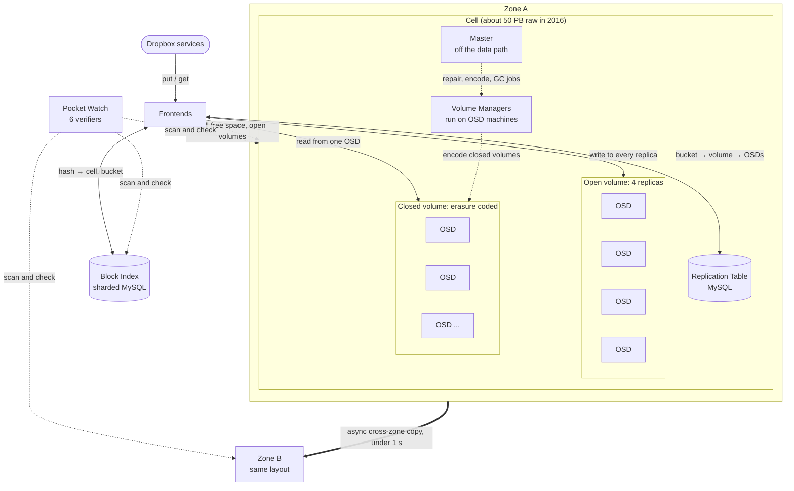
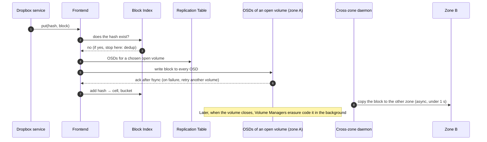
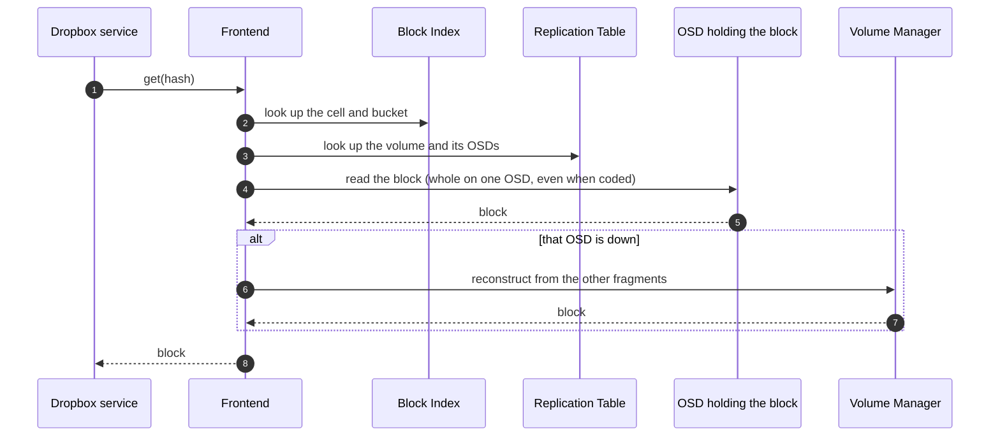
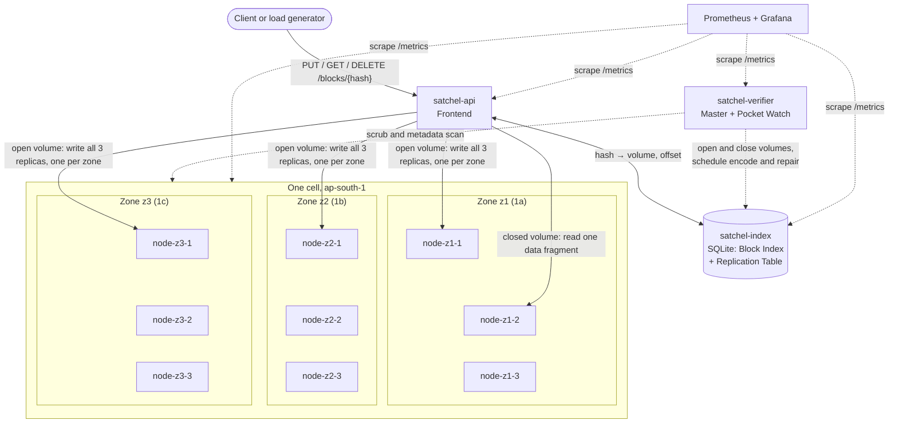
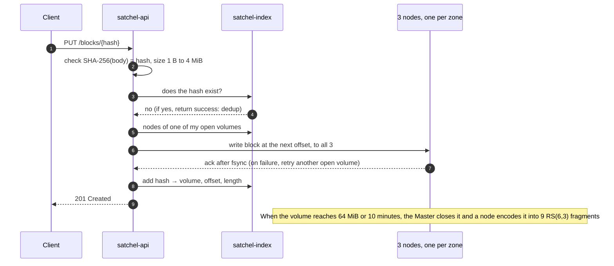
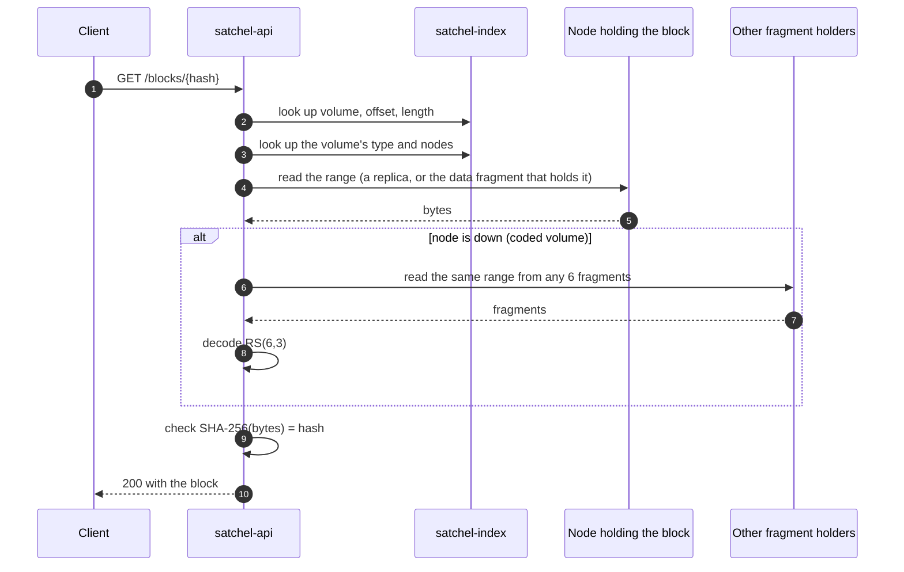

# Architecture: Magic Pocket and Satchel

Issue #11. Two matching diagrams: Magic Pocket as Dropbox described it, and Satchel as we're building it, with the put and get paths numbered. Objective 2 in the [project brief](../SATCHEL_PROJECT.md).

- The Magic Pocket half is drawn from the architecture notes ([`architecture.md`](../research/architecture.md), #8). Source IDs refer to the [Source Log](../sources/README.md).
- The Satchel half follows the exercise plan ([`exercise-plan.md`](exercise-plan.md), #14). Each simplification points to its entry in the [Design Decision Log](decision-log.md) (#17).
- The diagrams are Mermaid, so GitHub renders them and they diff in PRs.

## 1. Magic Pocket

### 1.1 Components

The layout is the 2016 design in [B2], with the erasure codes named in 2024 [T9]. Zone B has the same layout as zone A.

### 1.2 Put path

Steps from [B2], except step 8 [B2][B5].

If the Block Index fails during a put, the Frontend forwards the request to the other zone [B2].

### 1.3 Get path

Steps from [B2].

### 1.4 What each component does

| Component | Role | Source |
|---|---|---|
| Block | Immutable chunk of a file, up to 4 MB, keyed by SHA-256. Arrives compressed and encrypted | [B2] |
| Frontend | Gateway for puts and gets. Picks the volume for each new block to spread load and limit cross-cluster traffic | [B2] |
| Block Index | Maps each hash to a cell and bucket. A sharded MySQL cluster behind an RPC layer | [B2] |
| Zone | Geographic location holding a full copy of each block. At least two per block, thousands of miles apart | [B2], [B5] |
| Cell | Self-contained storage cluster, about 50 PB raw in 2016 and 100 to 120 PB in 2024. Capacity grows by adding cells | [B2], [T9] |
| Bucket and volume | Bucket: 1 GB of blocks written around the same time (1 to 4 GB by 2024). Volume: buckets stored on a set of OSDs, open for writes or closed and immutable | [B2], [T9] |
| Replication Table | Maps buckets to volumes and volumes to OSDs, with the volume's type and generation. MySQL, small enough to stay in memory | [B2] |
| Master | One per cell. Triggers repair, creates buckets, runs garbage collection. Soft state, so it stays off the data path | [B2] |
| Volume Manager | Moves and erasure codes volumes. Runs on the OSD machines to use their idle network capacity | [B2] |
| OSD | "Dumb" storage node: one daemon per disk, raw disk with no filesystem, no knowledge of the cell topology | [B2], [B4] |
| Replication | New data goes to open volumes: 4 copies within a zone, in two zones. The Frontend writes to every copy, no quorum | [B2], [T8] |
| Erasure coding | Closed volumes are coded in the background. RS(6,3) or LRC(12,2,2) in 2024. Most reads still hit a single disk | [B2], [T9] |
| Cross-zone replication | A daemon copies every put to the other zone asynchronously, within about a second | [B2] |
| Pocket Watch | Six verifiers, from the Disk Scrubber to the Cross-zone Verifier. Over half of disk and database load | [B3] |

## 2. Satchel

### 2.1 Components

Same shape as section 1.1. One cell spread over three zones, with 3 storage nodes in each. The open volume shows where a new block's 3 replicas go. The closed volume shows where its 9 RS(6,3) fragments go.

A closed volume's 9 fragments use all 9 nodes: 3 per zone, so losing a zone loses 3 fragments, which RS(6,3) tolerates (DDL-007). With 12 or 18 nodes, each volume uses 3 nodes from each zone.

### 2.2 Put path

### 2.3 Get path

### 2.4 What Satchel keeps and what it simplifies

| Magic Pocket | Satchel | Kept | Simplified | DDL |
|---|---|---|---|---|
| Blocks up to 4 MB, SHA-256 | Blocks up to 4 MiB, SHA-256 (`BlockHash`) | Immutable, content-addressed, dedup on put | No compression or encryption | DDL-001, 002 |
| Frontends | `satchel-api` | Gateway for put and get, picks the volume, writes all replicas | One instance, HTTP | DDL-002 |
| Block Index and Replication Table (MySQL) | `satchel-index` (SQLite) | Proven relational store behind a service, two tables | One unsharded database, offsets stored in the index | DDL-003 |
| Buckets of 1 to 4 GB, open and closed volumes | Volumes of 64 MiB, open and closed | Open volumes take writes, closed ones are immutable | Smaller unit, one bucket per volume | DDL-004 |
| Two or more zones far apart, many cells | Three AZs, one cell | Every block spans zones | AZs are kilometres apart, one cell | DDL-005 |
| 4 replicas per zone, async cross-zone copy | 3 replicas, one per zone, all synchronous | Write to every replica, fsync, retry, no quorum | 3 copies, no async daemon | DDL-006 |
| RS(6,3) or LRC(12,2,2) | RS(6,3), 3 fragments per zone | Same code, reads usually hit one node | No LRC, no cold tier | DDL-007, 008 |
| Master, Volume Managers | Master module in the verifier process, nodes act as Volume Managers | Soft-state coordinator off the data path, encoding on storage nodes | Shares a process with the verifier | DDL-009 |
| Repair after 15 minutes | Configurable threshold, 30 s in tests | Close volumes, rebuild, commit by generation | No Reconcile, rebuild on one node | DDL-010 |
| OSDs on raw SMR disks | `satchel-node` with extent files on EBS | Dumb nodes, fsync, inline metadata | Filesystem instead of raw disks | DDL-011 |
| Pocket Watch, six verifiers | `satchel-verifier`, two checks | Disk Scrubber and Metadata Scanner | Four verifiers left out | DDL-012 |
| Garbage collection and compaction | Index entry removed on delete | Deleted blocks can't be read | Space isn't reclaimed | DDL-013 |
| Dropbox's own data centers | EC2 Graviton instances, Terraform, Prometheus and Grafana | | Cloud VMs stand in for storage servers | DDL-015 |
