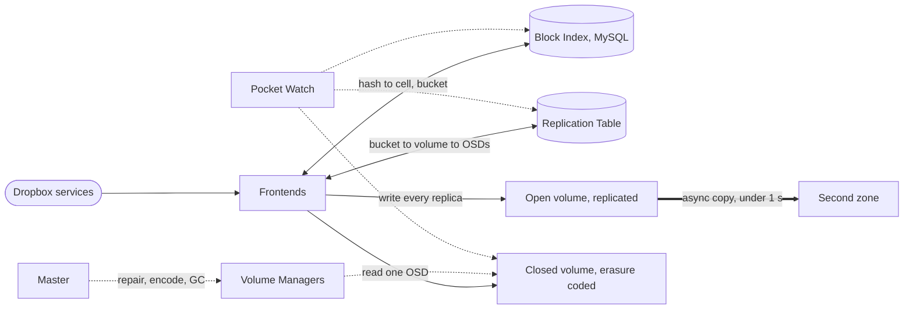
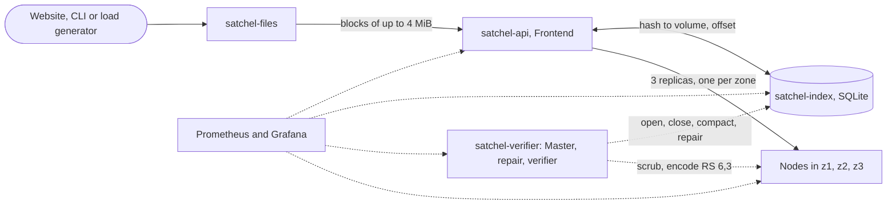
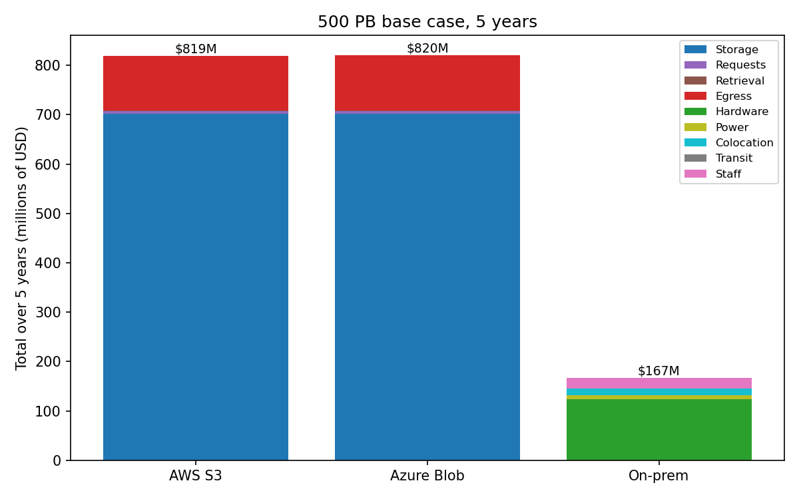
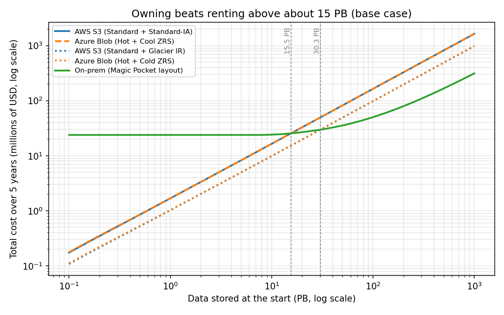
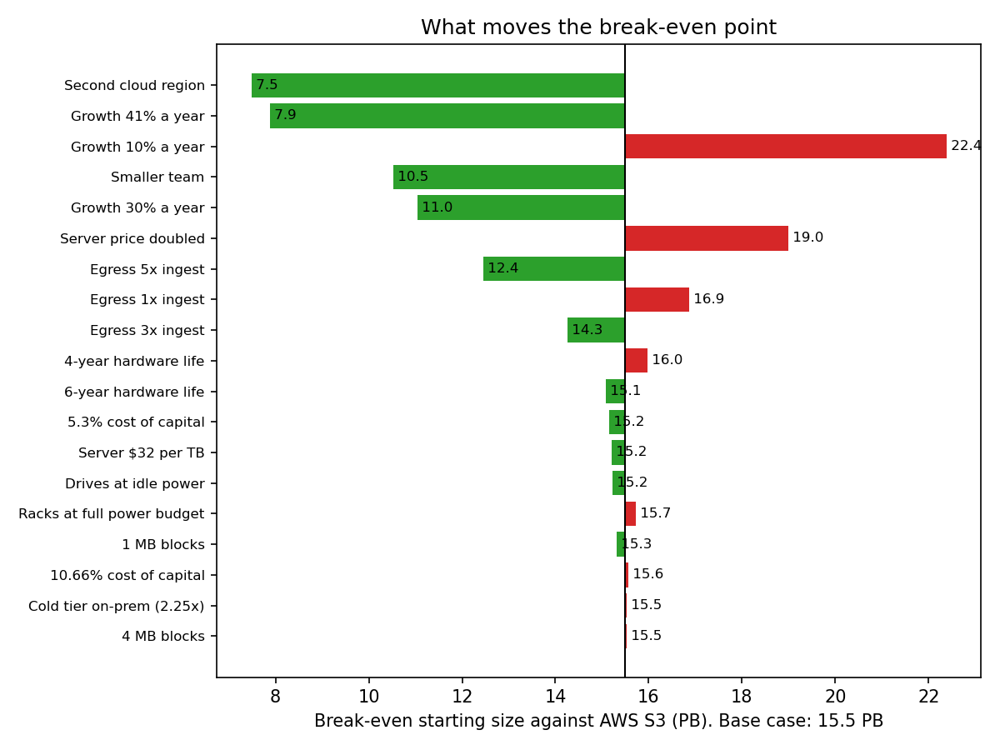

# Satchel: a pocket-sized Magic Pocket and the cost of owning storage

**Final report**
**Team:** Parshv Joshi, Guru Vyas and Jas Mehta
**Release described:** Satchel v2.0.0 (17 November 2026)
**Date:** 18 November 2026

Source IDs such as [B2] refer to the project [Source Log](../sources/README.md). Figures and interpretations that no source states are marked *(our calculation)* or *(our inference)*.

## Executive summary

Dropbox built Magic Pocket after the user data it kept on Amazon S3 grew from about 40 PB in 2012 to 500 PB by 2016. It said owning the storage stack would improve performance and unit economics at that scale, and by October 2015 it served more than 90% of user data from its own infrastructure [B1]. The audited result was a $39.5M fall in infrastructure costs in 2016 and a further $35.1M in 2017, across a wider programme that also cleaned up inactive accounts [F1, pp. 67, 71-73].

Satchel rebuilds Magic Pocket's core storage path in Rust at course scale. Files are split into immutable blocks of up to 4 MiB keyed by SHA-256, so identical content is stored once. New blocks are written to 3 replicas, one in each of 3 zones. When the operator runs `satchel compact`, the system reclaims space left by deletes and erasure codes closed volumes as RS(6,3), cutting raw storage from 3.0x to 1.5x of the data. A verifier checks stored bytes and metadata, and a repair loop rebuilds what a failed node held. Every one of these choices traces to a published Dropbox decision.

A cost engine prices Dropbox's workload on AWS, Azure and an owned, Magic Pocket-style system at 2026 list prices. Over 5 years at 500 PB, owning costs about $167M against $819M on S3 or Azure with an infrequent-access cold tier *(our calculation)*. Owning breaks even at about 15 PB, or about 30 PB against the cheapest instant-access cold tiers. We could not rent servers to measure a deployment at any of these sizes, so every cost in this report is an estimate.

## 1. Case study

### 1.1 Background and problem

Dropbox did not start as an all-cloud company. Its web and metadata services ran in its own data centres, while S3 held the contents of users' files. By 2016 Dropbox reported more than 500 million signups and 500 PB of user data, and it said no open-source system had been proven reliable at that scale, so it could not simply self-host an existing package [B1].

The company gave cost as the leading reason at its scale, but its comparison covered the whole hardware lifecycle: power, useful life, maintenance and replacement as well as purchase price [T6]. Owning the stack also let Dropbox co-design the block layout, repair traffic, network, dense SMR hardware and storage software [B4][T6]. A later talk reported median upload and download gains of about 40% to 300% depending on location, a network result rather than a general latency gain [T4].

The move also brought risk in-house. Durability, corruption detection, repair, capacity planning and capital spending moved from AWS to Dropbox. Its response was conservative: mirrored data, extra backups, per-user cutover, verification before deleting S3 copies, staged releases and human approval for destructive disk operations [B1][B3][T2][T5].

### 1.2 The solution and the migration

Magic Pocket is an immutable block store on custom software and high-density hardware in leased colocation space [B1]. Section 2 describes its architecture. The migration was staged so it could be reversed at every step.

| Date | Milestone |
|---|---|
| Summer 2013 | Magic Pocket became a major initiative after a small prototype [B1] |
| August 2014 | Dark launch, with data mirrored in two regions and extra backups [B1][T5] |
| 27 February 2015 | Selected user files served only from Dropbox's own infrastructure [B1][T5] |
| 30 April 2015 | Base Jump: fast server installation in three regions, transfers above half a terabit per second [B1] |
| 7 October 2015 | More than 90% of user data served in-house, without a major disruption or data loss during the move [B1] |
| Q4 2016 | The period of duplicated data between internal and third-party systems ended [F1, p. 67] |

Users moved one at a time: copy their blocks, verify the new copies, switch service, then retire the S3 copies. Running both systems was expensive but kept a way back [T5]. The result stayed hybrid. Dropbox kept AWS for the rest of its user data, for some regions and for workloads that still suited it [F1, p. 120][T5][B10].

The design kept changing after the move: SMR drives in production from 2018 [B4], a cold tier that cut disk use for cold data by 25% in 2019 [B5], removal of SSD write caches for 15% to 20% more write throughput by 2022 [B11], and RS(6,3) or LRC(12,2,2) codes with 100 to 120 PB cells by 2024 [T9].

### 1.3 Outcome

The S-1 filing calls the migration, inactive-account cleanup and later usage changes together **Infrastructure Optimization**. It shows the direction and size of the change, but it doesn't isolate Magic Pocket [F1, p. 67].

| Reported result | 2015 | 2016 | 2017 |
|---|---:|---:|---:|
| Revenue | $603.8M | $844.8M | $1,106.8M |
| Cost of revenue | $407.4M | $390.6M | $368.9M |
| Gross margin | 33% | 54% | 67% |
| Infrastructure-cost decrease | not reported | $39.5M | $35.1M |

Source: [F1, pp. 66-67, 71-73].

In 2016, third-party service-provider expense fell by $92.5M, partly offset by $53.0M more depreciation, facilities and support for Dropbox's own equipment [F1, pp. 71-73]. The two yearly decreases add up to $74.6M *(our calculation)*, but that is not a Dropbox-reported Magic Pocket saving. Dropbox has never published Magic Pocket's build cost, payback period or its AWS contract [F1]. Its durability figures, a 12-nines target and a 27-nines model, are a target and a model, not measured loss rates [B1][B3].

## 2. Architecture

### 2.1 Magic Pocket

The request path is narrow. A Frontend checks the Block Index for a block's hash, finds an open volume in the Replication Table and writes the block to every replica, each of which fsyncs before replying. A failed write is retried on another volume rather than settled by a quorum [B2]. A daemon copies each put to a second zone within about a second [B2]. A get reverses the lookups and normally reads the whole block from one disk, even when the volume is coded [B2].

| Component | Role |
|---|---|
| Block | Immutable chunk of a file, up to 4 MB, keyed by SHA-256, compressed and encrypted [B2] |
| Block Index | Sharded MySQL map from hash to cell and bucket, a system Dropbox already ran at scale [B2] |
| Bucket, volume | About 1 GB of blocks (1 to 4 GB by 2024), stored on a set of OSDs. Open volumes take writes. Closed ones are immutable and can be moved or coded [B2][T9] |
| Cell, Master | A cell is an isolated unit of capacity. Its Master triggers repair, creates buckets and runs garbage collection, with soft state off the data path [B2] |
| Volume Manager | Moves, repairs and erasure codes volumes, running on storage machines to use their idle network capacity [B2] |
| OSD | A deliberately simple daemon per disk that doesn't know the cell topology [B2][B4] |
| Pocket Watch | Six verifiers, from the Disk Scrubber to the Cross-zone Verifier, using more than half of disk and database load [B3] |

### 2.2 Satchel

Satchel keeps the same boundaries in one cell spread over three zones. On AWS the zones are the three availability zones of `ap-south-1`; on a laptop they are three groups of processes on one machine.

| Magic Pocket | Satchel | What Satchel simplifies |
|---|---|---|
| Blocks up to 4 MB, SHA-256 | Blocks of 1 byte to 4 MiB, SHA-256 | No compression or encryption |
| Frontends | `satchel-api` | One instance, HTTP and JSON |
| Block Index and Replication Table in MySQL | `satchel-index`, two tables in SQLite | One unsharded database, block offsets kept in the index |
| 1 to 4 GB buckets, open and closed volumes | 64 MiB volumes, open then closed | Smaller unit, so a small dataset still fills many volumes |
| Zones thousands of miles apart, many cells | Three AZs, one cell | AZs are kilometres apart, so no regional disaster protection *(our inference)* |
| 4 replicas per zone, async cross-zone copy | 3 synchronous replicas, one per zone | Fewer copies, no async daemon |
| RS(6,3) or LRC(12,2,2), background coding | RS(6,3), 3 fragments per zone, coded by `satchel compact` | No LRC or cold tier, manual rather than continuous coding |
| Master and Volume Managers | Master inside the verifier process | The Master also encodes, instead of the storage nodes |
| Repair after 15 minutes offline | Configurable threshold, 30 seconds in tests | One node rebuilds each volume, no Reconcile step |
| OSDs on raw SMR disks | `satchel-node`, extent files on a filesystem | Normal filesystem instead of raw disks |
| Six Pocket Watch verifiers | Disk Scrubber and Metadata Scanner | Four verifiers left out |

Each row has a full entry, with Dropbox's stated reasoning and source, in the project's [Design Decision Log](../design/decision-log.md).

## 3. Satchel implementation

### 3.1 Code layout

Satchel is about 15,000 lines of Rust in ten crates *(our count)*, following Dropbox's move from Go to Rust for its storage nodes [B4][T3].

| Crate | What it does |
|---|---|
| `satchel-common` | `BlockHash`, the RS(6,3) codec, service config, health checks and metrics |
| `satchel-api` | The Frontend: put, get and delete for blocks |
| `satchel-index` | Block Index and Replication Table over SQLite |
| `satchel-node` | Storage node: append-only extents for replicas and fragments |
| `satchel-verifier` | Master, compaction, repair, Disk Scrubber and Metadata Scanner |
| `satchel-files` | Whole files as ordered block lists, the API the website and local install use |
| `satchel-cost`, `satchel-calc` | The cost engine and CLI, and the same engine compiled to WASM for the calculator |
| `satchel-bench`, `satchel-it` | Load generator for Satchel and S3, and integration tests against a running cluster |

### 3.2 Writing a file

1. `satchel-files` splits an uploaded file into blocks of up to 4 MiB and hashes each with SHA-256. It records the file's ordered block list in a SQLite manifest with a reference count per block.
2. For each block, the Frontend checks that the body hashes to its key and is 1 byte to 4 MiB. It then asks the Block Index whether the hash exists. If it does, the put returns success without writing anything: identical content is stored once, as Magic Pocket's Frontends check the index before writing [B2].
3. Otherwise the Frontend appends the block to all 3 replicas of an open volume, one node per zone. Each node fsyncs before replying, and all three must report the same offset. If any replica fails, the volume is marked broken and the block is retried on another open volume, the same "write to all, retry elsewhere" rule Dropbox chose over quorum writes [B2].
4. The Frontend records `hash -> volume, offset, length` in the index. The index refuses a block whose volume has already closed, so a put that races a close gets a conflict and is retried, keeping closed volumes immutable [B2].

Deleting a file lowers each block's reference count. Blocks no other file uses lose their index entry and can't be read, but their bytes stay on disk until compaction.

### 3.3 Reading a file

The Frontend looks up each block's volume, offset and length. On a replicated volume it reads one replica, from its own zone first. On a coded volume it reads the byte range from the one data fragment that holds it, because data fragments are contiguous slices of the volume. If that fragment is missing, it reads the same byte range from any 6 of the 9 fragments and decodes it. Either way the block is checked against its SHA-256 before it is returned, so wrong bytes are never served.

### 3.4 Volumes, compaction and erasure coding

The Master keeps one open, replicated volume available and closes volumes at 64 MiB or after 10 minutes. It keeps no state of its own: each pass reads what it needs from the Replication Table, as Magic Pocket's Master keeps only soft state [B2]. If a zone is down, it places the third replica in a surviving zone so writes continue with three copies.

Volumes stay replicated, at 3.0x their data, until the operator runs `satchel compact`. Compaction refuses to start unless healthy nodes are up in all three zones, and only one runs at a time. It then:

1. closes every open volume that holds data;
2. retires closed volumes with no live blocks;
3. for a volume with deleted blocks, copies only the live blocks into a new volume and moves their index entries there;
4. encodes each volume as RS(6,3): the Master reads one replica, splits it into 6 contiguous data fragments plus 3 parity fragments, and writes them with checksums to 3 nodes in each zone;
5. checks that the fragments decode and that every live block can be read from the new layout, commits the change by bumping the volume's generation, and only then deletes the old replicas.

Coded data takes 1.5x its size [T8], half of the replicated layout. With 3 fragments in each zone, losing a whole zone loses exactly the 3 fragments RS(6,3) can rebuild *(our inference)*. This follows Magic Pocket's lifecycle of replicating new data and coding closed volumes [B2][B5], and its compaction, which copies live blobs into new volumes and retires the old ones [B15]. Dropbox runs both continuously in the background; Satchel runs them on command, because Dropbox hasn't published how long its volumes stay replicated.

### 3.5 Repair and verification

A node unreachable for longer than a threshold (15 minutes by default, as in Magic Pocket [B2], and 30 seconds in tests) is treated as failed. The Master rebuilds each replica or fragment it held on another node, preferring the same zone, and commits each move through the volume's generation number [B2].

The verifier runs two of Pocket Watch's six checks [B3]. The Disk Scrubber re-hashes stored bytes to find corruption. The Metadata Scanner checks that every index entry points at data that exists on its nodes. Findings are reported over HTTP and left to repair.

### 3.6 Running Satchel

| Environment | What runs |
|---|---|
| Local install | One command for macOS or Linux starts the index, 3 nodes (one per zone, each holding its zone's 3 fragment slots), the Frontend, the verifier and the files API, all on `127.0.0.1` |
| Docker Compose | 9 nodes, 3 per zone, plus Prometheus and a Grafana dashboard. Used for development and the integration tests |
| AWS (Terraform) | 9 `m7g.medium` nodes over the 3 AZs of `ap-south-1` and one `m7g.large` control instance, with an arm64 image on GitHub Container Registry |
| Website | A React site that stores files on a local Satchel install (own), or on S3 (rent) for signed-in admins, and shows each upload's blocks, dedup and per-zone copies |
| Calculator | The cost engine in the browser, compiled to WASM, so its numbers match the CLI exactly |

Every service exports Prometheus metrics labelled by route pattern, so block hashes never become label values. CI runs formatting, lints, unit tests, a Docker build, the Compose integration tests and Terraform checks on every pull request.

## 4. Cost and repatriation analysis

**These figures are estimates.** We could not rent servers to run Satchel at a meaningful size and compare what it actually costs against S3, so every number in this chapter comes from public list prices, published hardware and operating references, and our own model. None of them is a measured bill.

### 4.1 Method

One workload is priced three ways: AWS S3 in Mumbai, Azure Blob Storage in Central India, and an owned system in Magic Pocket's layout. The AWS and Azure figures match each provider's pricing calculator export to within 0.01%. The engine, `satchel-cost`, also drives the web calculator, so the report, the charts and the calculator share one model.

| Parameter | Base value | Basis |
|---|---:|---|
| Stored at the start | 500 PB | [B1] |
| Growth | 20% a year | [T5] |
| Horizon | 5 years, 2026 list prices | Our modelling choice |
| Average block | 2 MB | Within Magic Pocket's 1 to 4 MB range [B10] |
| Egress | 2x ingest | Assumption, tested at 1x to 5x |
| Hot data | Written in the last 12 months, 1/6 of stored | *(our calculation)* |
| Owned raw capacity | 3.0x: two regions, each RS(6,3) | [B2][T8][T9] |

At 20% growth, stored data reaches about 1,244 PB after 5 years, with about 744 PB ingested and 1,488 PB served *(our calculation)*. The owned system pays for hardware as an annuity at a 9.34% cost of capital [H18] over a 5-year life [H13], plus power [B12][H4][H6], colocation [H7], IP transit [H9] and a fixed team of 9 engineers and about 17 technicians at US pay [T9][H11][H15][H16][H17].

### 4.2 The base case: 500 PB

5-year totals, millions of dollars *(our calculation)*:

| Option | 5 years | Year 1 | Year 5 |
|---|---:|---:|---:|
| AWS S3, cold data on Standard-IA | 819.0 | 110.1 | 228.2 |
| Azure Blob, cold data on Cool ZRS | 819.8 | 110.2 | 228.4 |
| AWS S3, cold data on Glacier Instant Retrieval | 490.1 | 65.9 | 136.6 |
| Azure Blob, cold data on Cold ZRS | 490.9 | 66.0 | 136.8 |
| **Owned, Magic Pocket layout** | **166.7** | **23.8** | **44.8** |

- **Owning costs about a fifth of renting** at this size, and about a third of the cheapest cloud option.
- **A cloud bill is mostly storage.** On AWS, storage is 86% of the 5-year total and egress 14%. Requests are under 1%.
- **An owned system is mostly hardware.** The capital charge is $123.2M (74%), staff $20.7M (12%), colocation $13.9M (8%) and power $8.6M (5%).
- **Egress is where owning saves most per byte.** Serving 1,488 PB costs $110.9M in cloud egress fees but about $0.4M in transit, because transit is billed per Mbps of capacity [H9] and cloud egress per GB [P1][P6]. The transit figure has no peak-to-average factor, so it is a lower bound.
- **Running Satchel on rented VMs is the worst option**, about $7.0B over 5 years, because EBS gp3 costs $0.0912 per GB-month [P3]. Building your own storage pays only when you also own the disks *(our inference)*.

### 4.3 The break-even point

The engine runs the same workload from 100 TB to 1 EB and finds the smallest starting size at which owning costs no more over 5 years.

| Against | Break-even start size |
|---|---:|
| AWS S3, Standard + Standard-IA | **15.5 PB** |
| Azure Blob, Hot + Cool ZRS | **15.4 PB** |
| AWS S3, Standard + Glacier Instant Retrieval | 30.3 PB |
| Azure Blob, Hot + Cold ZRS | 30.2 PB |

Below about 10 PB the owned line is flat at about $24M over 5 years: the fixed cost of a team and an 18-server minimum across two regions. Cloud costs rise in step with data, while owned costs rise more slowly, so the lines cross in the mid-teens of petabytes. Dropbox, at 500 PB, was about 16 to 32 times past that point *(our calculation)*.

### 4.4 What moves the break-even point

Each input was changed one at a time against S3 with Standard-IA (base 15.5 PB) *(our calculation)*:

| Change | Break-even |
|---|---:|
| Cloud keeps a second region, as Magic Pocket does | 7.5 PB |
| Growth of 41% a year | 7.9 PB |
| Smaller team: 8 engineers, 1 technician on site [T9][H17] | 10.5 PB |
| Egress 5x ingest | 12.5 PB |
| 6-year hardware life [H13] | 15.1 PB |
| Server price doubled | 19.0 PB |
| Growth of 10% a year | 22.4 PB |

Growth and redundancy move the break-even point most, then the size of the team. The price, life and financing of hardware each move it by less than 25%. Even the worst case tested, 22.4 PB, is far below Dropbox's 500 PB.

### 4.5 Does this match what Dropbox reported?

| | Our model, year 1 at 500 PB | Dropbox, 2016 [F1] |
|---|---:|---:|
| Cloud spend | $110.1M (AWS list price) | Third-party spend fell $92.5M |
| Cost of owning | $23.8M | Own-equipment costs rose $53.0M |
| Net saving | $86.3M | Infrastructure costs fell $39.5M |

The direction matches and the cloud side is of the same size. Dropbox's saving is smaller, which we'd expect *(our inference)*: it paid for duplicated data until Q4 2016 [F1, p. 67], depreciated equipment over 3 years then [F2] where we use 5, probably paid less than list price at its scale, and our 2019 server price [H3] is probably low today, since drive prices alone have risen [H2].

## 5. Conclusions, limitations and future work

### 5.1 Conclusions

1. **Dropbox's decision was about fit, not a rejection of the cloud.** At hundreds of petabytes, with steady growth and a simple access pattern, owning storage was cheaper and gave Dropbox control of the hardware, network and software. It kept AWS where that still made sense [B1][T6][F1, p. 120].
2. **The design ideas work at small scale.** Satchel shows that content addressing, write-to-all replication across zones, immutable volumes and later erasure coding fit together in a small system, and that coding halves raw storage with a code that survives a zone loss.
3. **Repatriation has a threshold.** For this workload, owning beats renting above about 15 to 30 PB. Below that, a fixed team and minimum fleet make the cloud cheaper. The threshold falls with faster growth, more redundancy in the cloud and smaller teams.
4. **The saving comes from owning disks and bandwidth.** Running your own storage software on rented VMs and block storage is the most expensive option of all. The money is in the hardware and in transit priced by capacity rather than per gigabyte served.

### 5.2 Limitations

- **Every cost is an estimate.** We could not rent servers to run and measure Satchel, so no figure is a measured bill. Cloud prices are list prices, with no reserved capacity or negotiated discounts, and the owned side has no volume discount, spares, optics or shipping.
- **Staff is fixed at Magic Pocket's team** at every size, so the small end of the sweep overstates owned costs *(our inference)*. The cost of building the software isn't included.
- **2026 prices for a 2016 workload.** This answers what Dropbox's workload would cost today, not what Dropbox paid.
- **Satchel is not Magic Pocket.** Three AZs in one region don't survive a regional disaster, there is one cell, coding runs only on command, and four of the six verifiers are missing.
- **No measured performance.** Latency, throughput and recovery times are not reported, because the experiments below have not been run.
- **Gaps in the public record.** Dropbox never published the 2016 erasure code, its request mix, its AWS contract or a payback period [B3][F1].

### 5.3 Future work

- **Small-scale experiments.** Run the five planned experiments on the Compose cluster with `satchel-bench`, and a short S3 comparison from the AWS cluster:
  - E1: put and get latency from 4 KiB to 4 MiB blocks, against S3 in the same region;
  - E2: throughput and latency with 9, 12 or 18 nodes, 1 to 64 clients and up to 50 GiB stored;
  - E3: replication against erasure coding, for storage overhead, healthy and degraded reads, and encoding cost;
  - E4: behaviour through a node loss, a short restart, a zone loss and on-disk corruption;
  - E5: Satchel's own CPU, memory, disk and network use, to check the cost engine's sizing.
- **Horizontal scaling.** Add and remove storage nodes while the cluster runs.
- **Background compaction.** Code volumes continuously, rate-limited, as Magic Pocket does [B15].
- **More of Magic Pocket.** LRC codes and a cross-region cold tier [B5][T9], more Pocket Watch verifiers [B3], and a second cell.
- **A measured cost check.** Feed E5's resource figures into the cost engine and compare a short rented run with the model.

## References

The full record, with archive links and access dates, is in the [Source Log](../sources/README.md).

- **[B1]** A. Gupta, "Scaling to exabytes and beyond," Dropbox Tech Blog, 2016-03-14.
- **[B2]** J. Cowling, "Inside the Magic Pocket," Dropbox Tech Blog, 2016-05-06.
- **[B3]** J. Cowling, "Pocket watch: Verifying exabytes of data," Dropbox Tech Blog, 2016-07-06.
- **[B4]** Magic Pocket Hardware Engineering Teams, "Extending Magic Pocket Innovation with the first petabyte scale SMR drive deployment," Dropbox Tech Blog, 2018-06-12.
- **[B5]** P. Le, "How we optimized Magic Pocket for cold storage," Dropbox Tech Blog, 2019-05-06.
- **[B10]** L. Xing, "Everything in its write place: Cloud storage abstraction with Object Store," Dropbox Tech Blog, 2022-10-11.
- **[B11]** A. Kulshrestha, R. Goel and S. Ummadi, "Increasing Magic Pocket write throughput by removing our SSD cache disks," Dropbox Tech Blog, 2022-12-08.
- **[B12]** E. Shobe, "After four years of SMR storage, here's what we love and what comes next," Dropbox Tech Blog, 2023-03-08.
- **[B15]** F. Agriel, "Improving storage efficiency in Magic Pocket, our immutable blob store," Dropbox Tech Blog, 2026-04-02.
- **[T2]** D. Mah, "Bridging the Safety Gap from Scripts to Full Auto-Remediation," SREcon16 Europe, 2016.
- **[T3]** J. Turner, "Go-ing to Rust: Optimizing Storage at Dropbox," QCon San Francisco, 2016.
- **[T4]** J. Wilson, "Scaling for Exabytes: Dropbox," Network @Scale, 2017.
- **[T5]** J. Cowling, "Dropbox Background on Magic Pocket," Storage Field Day 15, 2018.
- **[T6]** J. Cowling, "Dropbox Competitive Advantages from Infrastructure," Storage Field Day 15, 2018.
- **[T8]** F. Agriel, "Magic Pocket: Dropbox's Exabyte-Scale Blob Storage System," QCon San Francisco, 2022.
- **[T9]** S. Ummadi and E. Shobe, "Scaling Magic Pocket: Exabyte Scale Object Storage System," SNIA SDC, 2024.
- **[F1]** Dropbox, Inc., Form S-1, 2018-02-23.
- **[F2]** Dropbox, Inc., 2018 Form 10-K, 2019-02-22.
- **[P1]** Amazon S3 pricing, Asia Pacific (Mumbai), read 2026-10-20.
- **[P3]** AWS Pricing Calculator, ap-south-1, read 2026-11-12.
- **[P6]** Azure Retail Prices API, Bandwidth, Central India, read 2026-10-20.
- **[H2]** eRacks, "HDD price per TB, March vs August 2026," press release, 2026-09-14.
- **[H3]** A. Klein, "Petabytes on a Budget: 10 Years and Counting," Backblaze, 2019-09-24.
- **[H4]** US EIA, Electric Power Monthly, Table 5.6.A, July 2026 data.
- **[H6]** Uptime Institute, Global Data Center Survey 2025: regional view.
- **[H7]** CBRE, North America Data Center Trends H1 2026: Northern Virginia.
- **[H9]** B. Boudreau, "IP Transit Pricing in 2026," TeleGeography, 2026-09-16.
- **[H11]** US BLS, Occupational Outlook Handbook: Network and Computer Systems Administrators.
- **[H13]** Amazon.com, Form 10-K for FY2025, 2026-02-06.
- **[H15]** US BLS, "Compensation costs for private industry workers averaged $46.89 per hour worked in June 2026," 2026-09-17.
- **[H16]** US BLS, Occupational Outlook Handbook: Software Developers.
- **[H17]** R. F. Van Loo, "Proper Data Center Staffing is Key to Reliable Operations," Uptime Institute Journal, 2015-03-12.
- **[H18]** A. Damodaran, Cost of Equity and Capital (US), January 2026.

### Supporting documents

The [architecture](../design/architecture.md) and [Design Decision Log](../design/decision-log.md) give the full diagrams and the reasoning for each design choice. The [cost comparison](../cost/comparison.md), [method](../cost/method.md) and provider estimates in [`docs/cost/`](../cost/) hold every input and output behind chapter 4.
