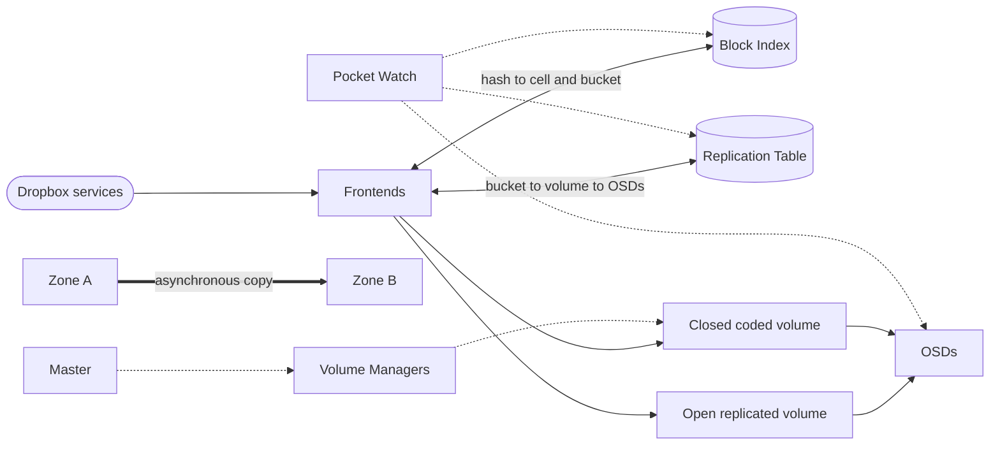
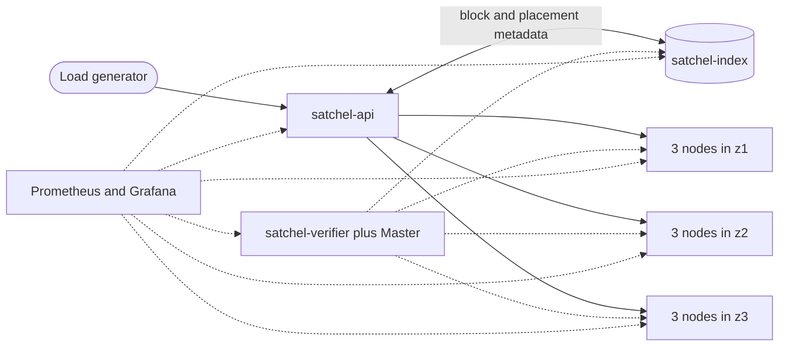

# Satchel: Dropbox Magic Pocket case analysis and exercise plan

**Week 2 report**
**Team:** Parshv Joshi, Guru Vyas and Jas Mehta
**Date:** 12 November 2026

Source IDs such as `[B2]` refer to the project [Source Log](../sources/README.md).
Calculations and interpretations that are not stated by a source are labelled
*(our calculation)* or *(our inference)*.

## Executive summary

Dropbox built Magic Pocket after its user-content store grew from about 40 PB
in 2012 to 500 PB by 2016. The company said that owning the storage stack could
improve performance and unit economics at that scale, while an expiring AWS
storage commitment imposed a hard migration deadline. This was a workload-fit
decision, not a general rejection of public cloud: Dropbox retained AWS for the
remaining user data, delivery, regional requirements and workloads that still
fit third-party infrastructure. [B1][T4][T6][F1, p. 120]

Magic Pocket stores immutable, content-addressed blocks behind Frontends, a
sharded MySQL Block Index and deliberately simple storage nodes. New data is
replicated, closed volumes are erasure coded, and background repair plus six
independent verifiers continuously test durability. Dropbox moved users in
stages while old and new copies coexisted. It reported serving more than 90% of
user data in-house by October 2015 without a major service disruption or data
loss during the migration. [B1][B2][B3]

The audited outcome was a $39.5 million infrastructure-cost decrease in 2016
and a further $35.1 million decrease in 2017. Those figures cover the wider
Infrastructure Optimization programme, including account cleanup and usage
changes, so they are not a disclosed Magic Pocket saving or payback period.
[F1, pp. 67, 71-73]

Satchel tests the same design ideas at course scale. The plan uses immutable
blocks up to 4 MiB, three synchronous replicas across three Mumbai availability
zones, 64 MiB volumes and background RS(6,3) coding across nine nodes. A shared
workload model prices the case on AWS, Azure and on-premises infrastructure,
while experiments compare latency, scaling, storage overhead, failure recovery
and cost. [B2][T8][T9]

## 1. The problem: why Dropbox left S3 for core storage

Dropbox did not start as an all-public-cloud company. Its web and metadata
services ran in its own data centres, while S3 held user file content. That
split supported rapid growth, but by 2016 Dropbox reported more than 500 million
signups and 500 PB of user data. No available open-source system had been
proven reliable at the required scale, so self-hosting an existing package was
not a shortcut. [B1]

### Scale, deadline and economics

Magic Pocket became a major initiative in summer 2013. Dropbox dark-launched
it in August 2014, first served selected files exclusively in-house in February
2015, and crossed 90% of user data in October 2015. The build combined new
storage software, dense hardware, a multi-terabit network and a live migration.
Transfers exceeded half a terabit per second; a later account reported more
than 6 PB per day and roughly 30 to 40 racks of new capacity per day. [B1][T4][T5]

The company described cost as the leading reason at Dropbox scale, but its
comparison covered the whole hardware lifecycle: power, useful life,
maintenance and replacement as well as purchase price. The public record does
not disclose the pre-migration AWS contract, Magic Pocket's total build cost or
a payback period. [T6][F1]

| 2016 infrastructure change | Reported amount |
|---|---:|
| Lower third-party service-provider expense | $92.5M |
| Higher depreciation, facilities and support | $53.0M |
| Net infrastructure-cost decrease | $39.5M |

Dropbox reported another $35.1 million decrease in 2017. Adding the two net
decreases gives $74.6 million *(our calculation)*, but calling that total Magic
Pocket savings would exceed the filing because Infrastructure Optimization also
covered inactive-account cleanup and later usage changes. [F1, pp. 67, 71-73]

### Control, performance and the risks brought in-house

Owning the stack let Dropbox co-design immutable block layout, repair traffic,
networking, dense SMR hardware and storage-node software. A later talk reported
median upload or download gains of about 40% to 300%, depending on location;
that is a network result, not a universal request-latency improvement. [B4][T4]

The move also transferred durability, corruption detection, repair, capacity,
capital and destructive maintenance risk from AWS to Dropbox. The response was
conservative: mirrored data, extra backups, per-user cutover, verification
before deleting S3 copies, staged releases and human approval for destructive
disk operations. [B1][B3][T2][T5]

## 2. Magic Pocket architecture

The live request path is deliberately narrow. A Frontend checks the Block Index
for a content hash, asks the Replication Table for placement, and writes every
replica before recording the block. Gets reverse those lookups and normally
read a complete block from one disk. A failed disk can be bypassed by
reconstructing from coded fragments. [B2]

| Component | Responsibility and design reason |
|---|---|
| Block | Immutable content of up to 4 MB, normally keyed by SHA-256. Mutability stays in a higher layer, and identical content can be deduplicated. [B2] |
| Block Index | Sharded MySQL mapping from hash to cell and bucket. Dropbox reused a relational system it already operated at scale. [B2][B3] |
| Bucket and volume | Blocks are grouped into buckets and volumes. Open volumes accept writes; closed volumes are immutable and safe for background movement or coding. [B2] |
| Replication Table | Maps buckets to volumes and volumes to OSDs, state, type and generation. Placement can change without rewriting every block entry. [B2] |
| Cell and Master | A cell is a repeatable, isolated capacity unit. Its soft-state Master creates buckets and triggers repair and garbage collection outside the data path. [B2] |
| Volume Manager | Moves, repairs and erasure-codes volumes on storage hardware, using otherwise idle network capacity. [B2] |
| OSD | One narrow daemon per disk. It stores bytes but knows nothing about cell topology or distributed coordination. [B2][B4] |
| Pocket Watch | Six verifiers cross-check bytes, metadata, reads, deletion, movement and cross-zone completeness. [B3] |

This separation answers different risks with different mechanisms: immutable
blocks simplify writes, relational metadata makes placement inspectable, cells
limit failures, replicas protect fresh data, coding lowers steady-state
overhead, and independent verification makes corruption observable. [B2][B3]

## 3. Migration, durability and reported results

New blocks first enter replicated open volumes. A 2022 account describes four
replicas in each of two zones before coding. A cross-zone daemon normally sends
the second-zone copy within about a second. After a volume closes, background
workers aggregate and erasure-code it. In 2024 Dropbox named RS(6,3) and
LRC(12,2,2) as production choices; these later parameters must not be projected
back as the undisclosed 2016 code. [B2][B3][T8][T9]

When an OSD remains offline for 15 minutes, the Master closes its volumes and
plans reconstruction. Volume Managers do the network-heavy work, a generation
change commits new placement, and reconciliation handles interrupted moves.
The delay avoids repair for ordinary restarts while bounding the vulnerability
window. [B2]

Pocket Watch then checks the system from several directions. Disk Scrubber
hashes stored bytes, Metadata Scanner compares index entries with physical
copies, Storage Watcher performs black-box reads, and other verifiers inspect
deletion, extent movement and cross-zone completeness. Dropbox reported that
verification caused more than half of disk and database load. [B3]

### A reversible migration

| Date | Milestone |
|---|---|
| Summer 2013 | Major initiative began after a smaller proof of concept. [B1] |
| August 2014 | Dark launch with mirrored regions and extra backups. [B1] |
| February 2015 | Selected user files served exclusively in-house after roughly six months of validation. [B1][T5] |
| April to October 2015 | Base Jump expanded capacity while transfer rates exceeded 6 PB per day. [T5] |
| October 2015 | More than 90% of user data served in-house without a major disruption or data loss during the move. [B1] |
| Q4 2016 | Filing dates completion of the broader duplicated-data transition. [F1, p. 67] |

Users moved individually: copy blocks, verify the new copies, switch service,
then retire old S3 copies. Keeping both systems was expensive but preserved a
rollback path. The result remained hybrid, with AWS retained for the remainder
of user content, delivery, locality and later internal workloads. [T5][F1,
p. 120][B10]

The strongest published outcomes are the audited cost changes, the reported
migration record and location-dependent network gains. Durability figures such
as the 12-nines target and later 27-nines model are a target and a model, not
observed annual data-loss measurements. [B1][B3]

## 4. Satchel exercise: scope and architecture

Satchel keeps Magic Pocket's component boundaries while shrinking capacity,
failure domains and service count enough for a course project. Every deliberate
choice is recorded in the Design Decision Log with its Magic Pocket counterpart,
source and simplification.

### Request and background paths

1. `PUT /blocks/{hash}` verifies the SHA-256 and size, checks for deduplication,
   appends to three replicas, waits for all three fsync acknowledgements, then
   records `hash -> volume, offset, length`.
2. `GET /blocks/{hash}` looks up the volume. A replicated read uses one copy; a
   coded read uses the data fragment containing the range, or any six fragments
   for degraded reconstruction.
3. A Master module in `satchel-verifier` supplies open volumes, closes full or
   old volumes, schedules coding and repair, and commits new placement through
   a generation number.
4. The verifier implements Disk Scrubber and Metadata Scanner equivalents.

The development environment has one API, one index, one verifier and nine
storage nodes: three in each simulated zone. The measured AWS environment uses
three availability zones in `ap-south-1`, nine storage nodes in the base case,
a control instance and a separate load generator. Availability zones are not
geographically distant Dropbox regions, so they do not model regional disaster
survival *(our inference)*. [B2][B5]

The exercise excludes production-grade durability, custom hardware and
Dropbox's file metadata or sync systems. Its purpose is to expose the design
trade-offs and measure a reproducible small system, not to claim equivalence
with an exabyte service.

## 5. Storage parameters and experiments

| Decision | Satchel value | Magic Pocket link |
|---|---|---|
| Block | 1 byte to 4 MiB, SHA-256, immutable | Blocks up to 4 MB, normally content-addressed [B2] |
| Index | SQLite service with Block Index and Replication Table tables | Separate sharded MySQL services [B2] |
| Volume | 64 MiB or 10 minutes open, then immutable | Open and closed buckets/volumes [B2] |
| New data | 3 synchronous replicas, one per zone | Replicated-first lifecycle; no quorum writes [B2][B5] |
| Coded data | RS(6,3): 6 data and 3 parity fragments on 9 nodes | Production option disclosed in 2024 [T8][T9] |
| Repair | 15 minutes by default, 30 seconds in tests | 15-minute OSD threshold [B2] |
| Verification | Scrubber plus metadata scan | Two of Pocket Watch's six checks [B3] |
| Delete | Remove index entry; no compaction | Production garbage collection and compaction omitted [B3][B15] |

RS(6,3) has 1.5x coded overhead and tolerates any three lost fragments. Putting
three fragments in each of three zones means one whole-zone loss removes exactly
three fragments *(our inference)*. This uses a published Dropbox code while
requiring only nine nodes; LRC(12,2,2) needs sixteen fragments and is outside
the project budget. [T8][T9]

The experiment matrix changes one factor at a time and repeats configurations
three times. Each measured run uses a 30-second warm-up and at least 10,000
operations, or stops at five minutes. The report will give the median and range,
along with sample counts.

| Experiment | Question | Measures |
|---|---|---|
| E1: block size | How do Satchel and S3 respond from 4 KiB to 4 MiB? | p50, p90, p99, p99.9, ops/s, MiB/s, errors |
| E2: scaling | What changes with 9, 12 or 18 nodes, 1 to 64 clients and 1 to 50 GiB stored? | Throughput, latency and per-node resources |
| E3: replication vs coding | What space and read cost does coding trade for lower overhead? | 3.0x vs 1.5x storage, healthy/degraded reads, encoding cost |
| E4: failures | Does data remain available through a node loss, short restart, zone loss or corruption? | Errors, latency, detection and repair time |
| E5: resource usage | What does Satchel consume in a 30-minute steady run? | CPU, memory, disk, network and bytes per node |

## 6. Workload and cost model

The same workload is priced on AWS, Azure and on-premises infrastructure. The
baseline is Dropbox at the end of the migration: 500 PB of user data, evaluated
for five years at 2026 prices. A scale sweep from 100 TB to 500 PB asks where
owning storage may beat renting it. Using current prices for a 2016-sized
workload is a modelling choice, not a historical AWS bill *(our inference)*.

| Parameter | Base value | Basis |
|---|---:|---|
| Stored at baseline | 500 PB | [B1] |
| Annual growth | 20% | More than 20% reported in 2018 [T5] |
| Average block | 2 MB | Assumption within the published 1-4 MB operating range [B10] |
| Year 1 ingest | 100 PB | Net growth, assuming no deletes |
| Year 1 egress | 200 PB | Assumption: twice ingest; sensitivity at 1x and 5x |
| Year 1 PUTs | 50 billion | Ingest divided by 2 MB *(our calculation)* |
| Year 1 GETs | 100 billion | Egress divided by 2 MB *(our calculation)* |
| Hot/cold split | 16.7% / 83.3% | Last 12 months at 20% growth *(our calculation)* |
| Durability target | More than 12 nines annually | [B1] |

At 20% growth, stored data reaches about 1,244 PB at the end of year five;
cumulative ingest is about 744 PB and cumulative egress about 1,488 PB *(our
calculation)*. Request rate, egress and average block size are the weakest
inputs, so every provider model must run their sensitivity ranges.

Cloud scenarios use hot and instant-read cold tiers, price API operations and
internet egress, and exclude archive tiers with hour-long restores. The primary
case uses one cloud region; an optional second geographic copy doubles storage
and adds inter-region transfer. [P1][P2][P5][P6]

The on-premises base uses two geographic copies, each RS(6,3), for 3.0x raw
capacity *(our calculation)*. A later cold-tier scenario uses 2.25x. Hardware,
power, colocation, network, staff and useful life are explicit inputs rather
than hidden inside one per-gigabyte number. The five-year horizon aligns with a
published five-to-six-year server life, while the Dropbox filing used shorter
depreciation periods. [H13][F1]

## 7. Test strategy and evidence plan

Satchel separates correctness tests from performance experiments. Unit tests
run without a network; integration tests drive the Compose cluster over HTTP;
the same suite targets AWS before experiments and release. Performance results
are measurements, not PR gates.

| Level | Main evidence | Trigger |
|---|---|---|
| Unit | Hashing, index rules, storage, coding combinations and configuration | Every PR |
| Integration | Put/get/delete, restart persistence, replication, verifier findings and service health | Every PR in a dedicated Compose job |
| End-to-end | Fresh 3-AZ deployment, integration suite and failure drills | Before experiments and release |

The initial harness already discovers every Compose service, checks health and
verifies each node's zone. Feature PRs add requirement IDs such as `TS-API-1`
for byte-for-byte put/get, `TS-REP-1` for one replica per zone, `TS-EC-2` for
every combination of three lost fragments and `TS-VER-1` for on-disk corruption
detection.

Test data is deterministic and covers 0 bytes, 1 byte, 4 KiB, 128 KiB, 1 MiB,
2 MiB, 4 MiB, 4 MiB plus one byte, duplicates and coding padding. Integration
tests use fresh seeded blocks, avoid sleeps by polling with timeouts, and keep
their total writes near 100 MB.

Failure injection mirrors the practices Dropbox disclosed: staging failures,
deliberate corruption and regular zone drills. Satchel stops one node, returns
it before and after the repair threshold, flips a byte, removes stored data and
stops a whole zone. Pass criteria cover availability, corruption reporting,
repair and the absence of false positives. [B3][T9]

Before an AWS experiment, the team runs the integration suite and node/zone
drills. Each cloud session starts from reviewed Terraform, records the commit
and configuration, exports required results, and ends with `terraform destroy`.
CI never receives AWS credentials and never applies infrastructure.

This evidence plan limits the conclusion: a green suite supports correctness
for the stated small-cluster requirements, while the experiment matrix supports
only measured behaviour on its named VMs and data sizes. Neither demonstrates
Dropbox-scale durability.

## 8. Team roles, delivery and limitations

| Member | Primary Week 2 ownership | Week 3 continuation |
|---|---|---|
| Parshv Joshi | Architecture diagram, exercise plan, Design Decision Log and Week 3 issue creation | Observability, load generator/S3 baseline and sizing model |
| Guru Vyas | Problem and solution sections, AWS groundwork and Week 2 report editing | Terraform, Docker image, first deployment and report add-ons |
| Jas Mehta | Workload model, test strategy, integration harness and roles editing | AWS/Azure cost models, cost engine and break-even analysis |

All PRs require an approval and green CI. Each member reviews report PRs. The
issue allocation gives Parshv and Guru eleven owned issues each, Jas ten, and
two lead roles each; shared deliverables and on-premises work remain collective.

### Delivery sequence

1. Merge the architecture, exercise plan and Design Decision Log.
2. Create the Week 3 component and experiment issues with owners and test IDs.
3. Confirm AWS account access, the `project=satchel` cost-allocation tag and the
   team-approved budget alert.
4. Merge this report after every section owner reviews it, then export the
   submitted PDF.

### Limitations and open decisions

- Dropbox never published the exact 2016 erasure code, request distribution,
  AWS contract or Magic Pocket payback period. Later parameters are dated and
  assumptions receive sensitivity tests. [B3][F1]
- S3 and Azure list prices do not represent negotiated Dropbox prices. The cost
  exercise answers what the modelled workload costs under stated 2026 inputs.
- Three availability zones in one AWS region are not equivalent to Dropbox's
  geographically distant regions *(our inference)*.
- Nine small VMs cannot validate exabyte-scale behaviour. They can expose the
  relative cost of replication/coding and the response to controlled failures.
- The report remains a draft until its open dependency PRs merge and the team
  agrees the AWS account, access model and budget amount.

The intended conclusion is therefore conditional: repatriation can improve the
economics of a large, predictable, specialised workload when an organisation
can fund and operate the full lifecycle. Dropbox's continuing hybrid design is
evidence that the right boundary depends on workload, geography and operational
capability, not a binary choice between cloud and owned infrastructure. [T6][T8]

## References

The full bibliographic record, archives, access dates and research notes are in
the [Source Log](../sources/README.md). Sources cited in this report:

- **[B1]** Akhil Gupta, “Scaling to exabytes and beyond,” Dropbox Tech Blog,
  2016-03-14. https://dropbox.tech/infrastructure/magic-pocket-infrastructure
- **[B2]** James Cowling, “Inside the Magic Pocket,” Dropbox Tech Blog,
  2016-05-06. https://dropbox.tech/infrastructure/inside-the-magic-pocket
- **[B3]** James Cowling, “Pocket watch: Verifying exabytes of data,” Dropbox
  Tech Blog, 2016-07-06. https://dropbox.tech/infrastructure/pocket-watch
- **[B4]** Magic Pocket Hardware Engineering Teams, “Extending Magic Pocket
  Innovation with the first petabyte scale SMR drive deployment,” 2018-06-12.
- **[B5]** Preslav Le, “How we optimized Magic Pocket for cold storage,”
  Dropbox Tech Blog, 2019-05-06.
- **[B10]** Lawrence Xing, “Everything in its write place: Cloud storage
  abstraction with Object Store,” Dropbox Tech Blog, 2022-10-11.
- **[B15]** Facundo Agriel, “Improving storage efficiency in Magic Pocket, our
  immutable blob store,” Dropbox Tech Blog, 2026-04-02.
- **[T2]** David Mah, “Bridging the Safety Gap from Scripts to Full
  Auto-Remediation,” SREcon16 Europe, 2016.
- **[T4]** Jason Wilson, “Scaling for Exabytes: Dropbox,” Network @Scale 2017.
- **[T5]** James Cowling, “Dropbox Background on Magic Pocket,” Storage Field
  Day 15, 2018.
- **[T6]** James Cowling, “Dropbox Competitive Advantages from Infrastructure,”
  Storage Field Day 15, 2018.
- **[T8]** Facundo Agriel, “Magic Pocket: Dropbox's Exabyte-Scale Blob Storage
  System,” QCon San Francisco 2022.
- **[T9]** Sandeep Ummadi and Eric Shobe, “Scaling Magic Pocket: Exabyte Scale
  Object Storage System,” SNIA SDC 2024.
- **[F1]** Dropbox, Inc., Form S-1, 2018-02-23, pp. 66-67, 71-73, 80 and 120.
  https://www.sec.gov/Archives/edgar/data/1467623/000119312518055809/d451946ds1.htm
- **[P1]**, **[P2]** AWS S3 pricing and storage-class documentation.
- **[P5]**, **[P6]** Microsoft Azure Retail Prices API, Central India storage
  and bandwidth results.
- **[H13]** Amazon.com Form 10-K for FY2025, server and network useful lives.

### Linked project documents

The detailed problem and solution sections, architecture, exercise plan,
workload model, test strategy, Design Decision Log and team roles remain the
reviewable source documents for this edited report. The final PDF uses these
same ten fixed section boundaries so page references remain stable.
