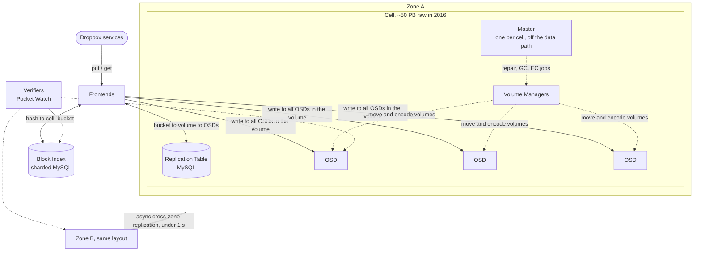

# Magic Pocket architecture

Research notes for [#8](https://github.com/frectrium/Satchel/issues/8). How Magic Pocket is built: what each component does, how it works, and the reason Dropbox gave for designing it that way.

- **Sources:** blog posts `B1` to `B15` ([notes](dropbox-tech-blog.md)) and talks `T1` to `T10` ([notes](conference-talks.md)), all primary. Media (`M`) is used only to point at leads, never as the source of a fact.
- **Dated snapshots:** Magic Pocket changed a lot between 2016 and 2026. Each figure is tied to the source that reported it. Don't mix a 2016 figure with a 2024 one without saying so.
- Anything we work out ourselves is marked *(our inference)*.

## Contents

1. [Overview](#1-overview)
2. [Components](#2-components)
3. [Request paths: put, get and repair](#3-request-paths-put-get-and-repair)
4. [Scale over time](#4-scale-over-time)
5. [Design principles Dropbox gave](#5-design-principles-dropbox-gave)
6. [Open questions for the exercise plan (#14)](#6-open-questions-for-the-exercise-plan-14)

## 1. Overview

Magic Pocket (MP) stores Dropbox's file content. File metadata lives in separate systems, such as FileJournal [B2]. MP is an immutable block store:
- Files are split into blocks of up to 4 MB, and a block never changes once written [B2].
- Blocks are replicated when first written and erasure coded later [B2][B5][T8].
- Each block is stored independently in at least two geographic zones [B2][B5].

Based on [B2] and [B3]. Zone B has the same internal layout as zone A.

## 2. Components

### 2.1 Blocks: immutable and content-addressed

- **What:** opaque chunks of files, "up to 4MB in size". They're compressed and encrypted before they reach MP. The key is "for most of our use-cases" the SHA-256 hash of the block [B2].
- **Immutable:** "once a block is written to the system it never changes". Edits are recorded higher up, in FileJournal [B2].
- **Why:** "Immutability makes our lives a lot easier." It moves the logic for mutability "higher up in the stack" [B2]. Dropbox later noted the cost: deletes leave space behind that has to be reclaimed by compaction [B15].
- **Dedup:** a put first checks the Block Index to see if the block already exists [B2].
- **Optimal size:** MP "was designed to run optimally with a homogenous 1-4 MB object size" [B10].

### 2.2 Buckets, volumes and extents

| Unit | What it is | Size | Source |
|---|---|---|---|
| Bucket | Logical container of blocks uploaded around the same time | 1 GB (2016). 1 to 4 GB (2024) | [B2], [T9] |
| Volume | One or more buckets stored on a set of OSDs, replicated or erasure coded | n/a | [B2] |
| Extent | A volume's copy on one storage node | 1 GB (2016–2019). 1 to 2 GB (2022) | [B3], [B4], [B11], [T8] |

- **Why buckets:** 4 MB is "too small a unit of granularity to move around whenever we need to replace a disk or erasure code some data" [B2].
- **Open and closed volumes:** an open volume accepts new writes and nothing else. A closed volume is immutable "and may be safely moved around the cell". Only a few volumes are open at a time [B2].
  - **Why:** the split keeps live traffic from interfering with background work, and "allows us to use far simpler consistency protocols" [B2].
- **On disk:** a 1 GB extent maps to four 256 MB SMR zones (4 × 256 MB = 1 GB) [B4][B7][T7].

### 2.3 Zones and regions

- **Layout:** server clusters in western, central and eastern US [B2], described in 2022 as "three geographical regions in North America" [T8]. B2 calls them zones and B5 calls them regions. We treat these as the same unit *(our inference)*.
- **Placement:** "Each block in MP is stored independently in at least two separate zones and then replicated reliably within these zones" [B2]. The data centers are "thousands of miles apart" [B5].
- **Cross-zone replication:** a daemon copies every put to the other zone asynchronously, "within one second" [B2]. If the Block Index fails during a put, the Frontend forwards the request to the other zone [B2].
- **Why:**
  - Protection against disasters and large outages, plus "very clear administrative domains" so that "a misconfiguration or congestion collapse" can't cascade across zones [B2].
  - Each region can run a different software version, so a bug is unlikely to hit every copy at once. Dropbox called this an "invaluable last line of defense" [B5].
- **Cost:** "We effectively store double the amount of data we would otherwise" [B5].
- **Testing:** by 2024 Dropbox took a full zone offline automatically for about 30 minutes each week [T9].

### 2.4 Cells

- **What:** "self-contained logical storage clusters that store around 50PB of raw data" (2016). Capacity is added by bringing up a new cell. Each cell is striped across racks for physical diversity [B2]. About 100 to 120 PB per cell by 2024 [T9].
- **Size limit:** one Master per cell supports "around a hundred petabytes before the memory and CPU overhead becomes a bottleneck" [B2].
- **Why cells:** convenient for deployment and "greater isolation to avoid cascading failures" [B2].

### 2.5 Frontends

- The gateway to MP. They decide where a block goes and issue reads and writes inside MP [B2].
- They poll each cell for free space and its list of open volumes [B2].
- They pick a volume "to evenly distribute cell load and minimize network traffic between storage clusters" [B2].

### 2.6 Block Index

- **Schema:** `hash → cell, bucket, checksum`. The real schema also supports deletes and cross-zone replication [B2].
- **Implementation:** "a giant sharded MySQL cluster, fronted by an RPC service layer" [B2].
- **Why MySQL instead of a custom key-value store or DHT:**
  - Dropbox already ran thousands of MySQL nodes and had the operational skills [B2].
  - Databases "are highly reliable and provide an expressive data model" [B2].
  - It "turned out to be a really great decision in terms of simplifying development and minimizing unknowns" [B2].
  - Its tables are easy to scan for verification [B3].
- **Verification:** the Metadata Scanner walks it at about a million blocks per second, a full pass roughly weekly [B3].

### 2.7 Replication Table

- **Schema:** `bucket → volume` and `volume → OSDs, open, type, generation` [B2].
  - `type`: replicated, or one of the erasure coding schemes.
  - `generation`: keeps moves consistent during repair [B2].
- MySQL, much smaller than the Block Index and updated less often. Its working set fits in memory [B2].

### 2.8 Master and Volume Managers

- **Master** (one per cell), the cell's "janitor or coordinator" [B2]. It:
  - watches OSDs and triggers repair;
  - creates buckets;
  - triggers garbage collection;
  - merges buckets that have become small.
- **Soft state:** the authoritative state is in the Replication Table, so the Master is "not on the data plane". The cell keeps serving reads without it, and can take writes until it runs out of buckets [B2].
- **Why one Master:** a "centralized point of coordination for complex data-placement decisions without the significant complexity of a distributed protocol" [B2].
- **Volume Managers:** do the heavy work of moving and erasure coding volumes. They run on the OSD machines "to amortize their heavy network-capacity demands across idle storage hardware" [B2].

### 2.9 Storage nodes (OSDs)

- **"Dumb" nodes:** they store blocks "but don't understand the cell topology or participate in distributed protocols" [B2].
- **Design:**
  - One daemon per disk, and only that daemon touches the disk.
  - The disk is used as a raw block device with no filesystem, so the OSD controls data layout and head movement [B4][B7].
  - Talks to SMR disks through `libzbc` [B4][B7][T7]. Moving to `libzbd` and kernel zoned-device support was under way in 2023 [B12].
- **Metadata:** kept in an in-memory index of blocks and their offsets. This is why a 2018 host has 96 GB RAM [B4]. Since 2022, block metadata is stored inline in the extent, and the index is rebuilt on startup [B11].
- **Write cache:**
  - SMR hosts originally committed live writes to an SSD and flushed them to disk later [B4].
  - The SSD capped write throughput per host, and an early-2020 wave of SSDs wearing out at once forced mass repairs [B11].
  - All SSDs were removed by the end of Q1 2022 [B11]. Fleet write throughput rose 15–20% [B11]. T9 reports puts per host going from about 500 to 1,500 per second [T9].
- **Language:** Go, then Rust (section 2.15).

### 2.10 Replication

- **New data:** "Recently uploaded blocks get replicated directly onto multiple machines" [B2].
- **Copy count:**
  - Open volumes are "4x replicated" within a zone, across two zones [T8].
  - Vyas's notes on T5 describe the early layout the same way: four copies in each of two locations, eight in total before erasure coding [T5].
  - T9 also gives 4x initial replication [T9].
- **Write rule:** the Frontend writes to **every** OSD in the volume, and each one fsyncs before replying. If any fails, the Frontend retries on another volume [B2].
- **Why not a quorum write:** a quorum might lower tail latency, "but at the expense of greater complexity". Retries with careful timeouts "already results in low tail latencies" [B2].

### 2.11 Erasure coding

- **When:** closed volumes are aggregated and erasure coded in the background "for storage efficiency" [B2][B5].
  - By 2026 Dropbox uses erasure coding "for nearly all data" [B15].
  - A newer **Live Coder** service writes some data straight into erasure-coded volumes, skipping the replicated first write. It suits background work rather than latency-sensitive traffic [B15].
- **Scheme:**
  - 2016: "a variant on Reed-Solomon erasure coding that is similar to Local Reconstruction Codes", parameters not given [B3].
  - 2022 talk: RS(6,3) at 1.5x overhead, and an LRC 12,2,2 example. The speaker said Magic Pocket uses "something very similar" to Microsoft's LRC, without naming exact production parameters [T8].
  - 2024: RS(6,3) or LRC(12,2,2) named as the production choices [T9].
  - Don't project the 2024 parameters back onto 2016 [B3][T9].
- **Reads:** the encoding lets each block be read whole from one OSD, so "most reads only hit a single disk spindle". If that OSD is down, the Frontend reconstructs the block with the Volume Manager's help [B2].
- **Why:** "the same level of fault tolerance as replication, but with significantly less additional storage" [B15].
- **Cold tier (2019), across regions:**
  - Each block is split into two fragments plus an XOR parity fragment, one per region.
  - Reads ask all three regions and use the fastest two.
  - Overhead drops from 2x to 1.5x, saving 25% of disk [B5][T8].

### 2.12 Repair

- **Trigger:** an OSD offline for **15 minutes**. That's long enough to restart a node without needless repair, and short enough to keep the window of vulnerability small [B2].
- **Steps** [B2]:
  1. Close the failed OSD's volumes.
  2. Plan the reconstruction across hundreds of OSDs, to spread the load.
  3. Volume Managers copy and encode the data.
  4. Commit by bumping the volume's generation number, then updating the Replication Table.
- **Safety:** any node can fail at any point without leaving the system inconsistent. A background process, Reconcile, rolls back failed repairs [B2].
- **Speed:** bad disks are usually re-replicated "in less than an hour" [B3]. In 2022, about four extents were repaired per second, with a repair SLA under 48 hours [T8].
- **Automation guardrails:** precondition checks, rate limits and a human gate for destructive disk operations [T2].

### 2.13 Verification (Pocket Watch)

| Verifier | Checks | Source |
|---|---|---|
| Disk Scrubber | Every bit on disk against checksums. Full sweep every 1–2 weeks | [B3] |
| Trash Inspector | Deleted extents only held blocks that were moved or deleted. Trash then kept one more day | [B3] |
| Extent Referee | Every move or unlink matches an approved trash inspection | [B3] |
| Metadata Scanner | Every Block Index entry is on the right storage nodes, about 1M blocks/s | [B3] |
| Storage Watcher | Black-box fetch of 1% of writes after a minute, hour, day, week and month | [B3] |
| Cross-zone Verifier | Every file in FileJournal is stored in all its zones | [B3] |

- **Cost:** "more than 50% of the workload on our disks and databases is actually our own internal verification traffic" [B3].
- **Releases:**
  - Verifiers run for at least a week on a Staging cluster that serves live traffic, before a release moves on [B3].
  - In 2022 a release took about four weeks through durability stages, with automatic aborts [T8].
- **Testing the verifiers:**
  - Data is deliberately corrupted in staging to check the verifiers catch it [B3].
  - By 2024 every invariant was tested weekly [T9].
- **Durability figures:**
  - The design target is annual durability over 99.9999999999% [B1][B4].
  - A Markov model gives 27 nines [B3].
  - These are targets and models, not measurements.

### 2.14 Deletes, garbage collection and compaction

- Deletes don't free space immediately. Closed volumes are never reopened [B15].
- **Garbage collection** marks unreferenced blobs. **Compaction** copies live blobs into new volumes and retires the old ones [B15].
- **Trash:** deleted extents first go to "trash" on the node and are only unlinked after inspection [B3].
- **Compaction strategies (2026):**
  - L1 packs donor volumes into well-filled hosts.
  - L2 packs several sparse volumes into one, using dynamic programming.
  - L3 streams the sparsest volumes through Live Coder.
  - All are rate-limited and kept within a cell [B15].
- **Scale:** "trillions of blobs" and "millions of deletes each day" [B15].

### 2.15 Hardware and languages

**Storage hardware over time**

| Year | Design | Key figures | Source |
|---|---|---|---|
| Early | First chassis | Around 240 TB | [B4] |
| 2016 | OSD | Over 1 PB per machine, over 8 PB per rack | [B2] |
| 2018 | SMR chassis | About 100 LFF disks in 4U, 14 TB drives, 1.4 PB per host, 8 chassis per rack, 96 GB RAM, 50 Gbps NIC, 100 Gbps uplinks | [B4], [T7] |
| 2022 | Scooby (6th gen) | More than 100 drives, over 2 PB per server, over 20 PB per rack, 100 Gb NIC | [B9] |
| 2023 | 7th gen in design | Aimed at more than 6 PB per enclosure. Network redesigned to drain and repair at an acceptable rate | [B12] |
| 2025 | Sonic (7th gen) | Drives up to 32 TB, about 200 Gbps per system. Internal standard 30 Gbps per PB | [B14] |

- **SMR share:** about 25% of the fleet in 2019 [B12], 90% in 2023 [B12], about 98% in 2024 [T9], over 99% in 2025 [B14].
- **Why SMR:** "greater bit density and better cost structure ($/GB)". MP's append-only, immutable extents suit SMR's sequential writes [B4].
- **Why network bandwidth matters:** denser hosts are a bigger failure domain. That's acceptable "as long as the recovery time meets our SLA", so each host needs enough bandwidth to drain quickly [B4].
- **Diskotech:**
  - The custom storage hardware is named in the 2016 talk abstract [T3].
  - B3 promised a post on "our Diskotech architecture" that we couldn't find.
  - Media descriptions of it are leads only [M3].

**Languages**

- **History:** a Python prototype, then Go, then Rust for the storage nodes [T5].
- **Reason:** "Moving from Go to Rust also allowed us to handle more disks, and larger disks, without increased CPU and Memory costs by being able to directly control memory allocation and garbage collection" [B4]. The talks give the same reason: Go runtime limitations [T9], and choosing Rust over Go for the fleet [T3].

## 3. Request paths: put, get and repair

Input for the architecture diagram (#11). Steps are from [B2] unless marked.

**Put**
1. The Frontend checks the Block Index. If the block already exists, it's done (dedup).
2. It picks an open volume, using the free space and open-volume lists it polls from each cell.
3. It looks up that volume's OSDs in the Replication Table.
4. It writes the block to every one of those OSDs. Each fsyncs before replying.
5. On success, it adds the Block Index entry and returns.
   - If an OSD failed, it retries with another volume, possibly in another cell.
   - If the Block Index failed, it forwards the request to the other zone.
6. The cross-zone daemon copies the block to the other zone within about a second.
7. Later, when the volume is closed, it's erasure coded in the background [B2][B5].

**Get**
1. The Frontend looks up the cell and bucket in the Block Index.
2. It looks up the volume and OSDs in the Replication Table.
3. It reads from one OSD. The block is whole on that OSD even when erasure coded.
4. If that OSD fails, it reconstructs the block from the other fragments with the Volume Manager's help.

**Repair:** see section 2.12.

## 4. Scale over time

| When | Data | Hardware | Source |
|---|---|---|---|
| 2012 | About 40 PB | n/a | [B1] |
| 2016 | 500 PB of user data, 500M+ signups | Over half a million disks | [B1], [B3] |
| 2017 | Near 700 PB, heading to 1 EB | n/a | [T4] |
| 2018 | About 1 EB, over 20% annual growth | Over 50,000 servers, over 12 MW | [T5] |
| 2019 | Over 1,000 PB of user block data | Over 12,000 OSD machines, over 650,000 disks | [T7] |
| 2022 | n/a | Over 600,000 drives, 3 North American regions | [T8] |
| 2025 | "exabyte era" | Tens of thousands of servers, millions of drives | [B14] |

## 5. Design principles Dropbox gave

1. **Keep it simple.** "The primary design principle here is keep it simple!" [B2]
2. **Centralize coordination instead of using consensus.** MP "eschews quorum-style consensus or distributed coordination as much as possible" [B2].
3. **Use proven components.** MySQL for the indexes rather than a new key-value store [B2].
4. **Push mutability up the stack.** Immutable blocks below, FileJournal above [B2].
5. **Isolate failure domains.** Independent zones and regions, cells and per-region software versions [B2][B5].
6. **Verify everything, all the time.** A large share of code and capacity goes to verification [B3][T5].
7. **Co-design hardware and software.** Dense SMR hardware built around the OSD's sequential writes [B4][B9].
8. **Small team.** "Most of MP was built by a team of less than half a dozen people" [B2]. About 8 to 10 engineers ran the storage software in 2024 [T9].

## 6. Open questions for the exercise plan (#14)

**What the sources don't tell us**

- **When data is erasure coded.** No source gives how long a volume stays replicated before it's encoded.
- **Which code was used when.** RS(6,3) and LRC(12,2,2) are named for 2024 [T9]. The 2016 parameters were never published [B3].
- **Placement inside a zone.** How the four replicas are spread across racks or hosts. B2 only says cells are striped across racks.
- **Block Index sharding.** How the MySQL cluster is sharded, and how the index handles deletes and refcounts for deduplicated blocks [B2].
- **OSD index format.** Beyond "an in-memory index of blocks and their offsets/length" [B4].
- **Encryption and compression.** Blocks arrive compressed and encrypted [B2], but the algorithms and key management for MP blocks aren't described. Object Store's AES-256 scheme [B10] is a different system.

**Decisions Satchel has to make, with the Magic Pocket choice to start from** *(our inference throughout)*

| Decision | Magic Pocket | Consideration for Satchel |
|---|---|---|
| Block size and key | Up to 4 MB, SHA-256 [B2] | Already matches `BlockHash` in `satchel-common` |
| Replication before EC | 4 copies in each of 2 zones [T8] | We have 3 AZs and few nodes. Fewer copies per zone is likely, logged as a simplification |
| EC scheme | RS(6,3) or LRC(12,2,2) [T9] | RS(6,3) needs at least 9 OSDs per volume. That drives the node count in #14 |
| Cross-zone | Async, under 1 s, at least 2 zones [B2] | 3 AZs in ap-south-1 can stand in for regions, but they're kilometres apart, not thousands of miles |
| Cells | 50–120 PB, one Master each [B2][T9] | One cell is enough at our scale |
| Index store | Sharded MySQL [B2] | A single database is enough. Sharding is a simplification to log |
| Repair trigger | 15 minutes offline [B2] | Shorten it for experiments, so failure tests finish in a reasonable time |
| Verification | Six verifiers [B3] | Pick the subset the verifier crate will implement (Disk Scrubber and Metadata Scanner are the natural first two) |
